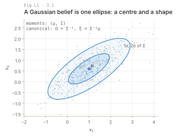
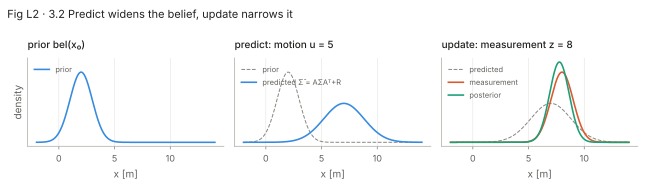
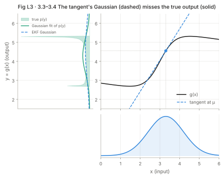
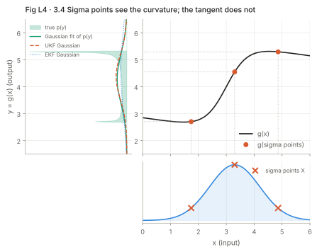
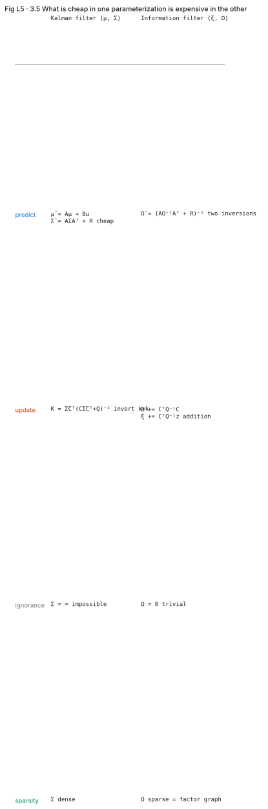

# Lecture: Gaussian filters

Each section is taught in four layers: the picture, the intuition, the formal statement, and where it meets your robots. Equation numbers are the book's. Code is in `translate.md`; nothing here is a solution to an exercise.

---

## L1. The one assumption (3.1)

**Picture.** A belief is a blob. In this chapter the blob is always an ellipse (an ellipsoid in n-D): a centre μ and a shape Σ. Nothing else about the blob is stored.



**Intuition.** Carrying only μ and Σ is cheap, closed-form, and fine as long as the truth is "one place, with some spread". It is wrong the moment the truth is "one of two places". The chapter never fixes that; chapter 4 does.

**Formal.** The multivariate normal (3.1):

```latex
p(x) = \det(2\pi\Sigma)^{-1/2} \exp\{-\tfrac12 (x-\mu)^T \Sigma^{-1} (x-\mu)\}
```

μ ∈ ℝⁿ, Σ ∈ ℝⁿˣⁿ symmetric positive semidefinite. Two parameterizations describe the same Gaussian: the moments (μ, Σ) and the canonical (ξ, Ω) with Ω = Σ⁻¹, ξ = Σ⁻¹μ (3.70–3.73). They are duals: whatever is cheap in one is expensive in the other.

**Your robots.** The tracked robot's pose in a known map is one blob most of the time; the quadruped's body state fused from IMU and leg odometry is one blob; a drone's position from GPS and IMU is one blob. Global relocalization after a kidnap is not. Thrun's Σ grows as n², so a planar EKF-SLAM map with 1000 landmarks stores a (3 + 2·1000)² ≈ 2003×2003 dense covariance. That number is why 3.5 and later chapter 12 exist.

---

## L2. The Kalman filter (3.2)

**Picture.** Figure 3.2 in the book, redrawn: a Gaussian slides right and widens when the robot moves (predict), then narrows and shifts toward a measurement when a sensor reads (update). The result is always narrower than either input.



**Intuition.** Predict: push the mean through the motion, push the covariance through the motion twice (once per side), add process noise. Update: compare what you expected to measure with what you did measure (innovation), and move the mean by a fraction of that difference. The fraction is the Kalman gain. It is large when the prior is uncertain and the sensor is good; small when the reverse.

**Formal.** Three assumptions make the posterior exactly Gaussian (pp. 40–42):

```latex
x_t = A_t x_{t-1} + B_t u_t + \varepsilon_t, \quad \varepsilon_t \sim \mathcal N(0, R_t) \qquad (3.2)
```
```latex
z_t = C_t x_t + \delta_t, \quad \delta_t \sim \mathcal N(0, Q_t) \qquad (3.5)
```
```latex
bel(x_0) = \mathcal N(x_0; \mu_0, \Sigma_0) \qquad (3.7)
```

Shapes: A n×n, B n×m, C k×n, R n×n, Q k×k. Then Table 3.1:

| Line | Equation | Step |
| --- | --- | --- |
| 2 | μ̄ₜ = Aₜ μₜ₋₁ + Bₜ uₜ | predict mean |
| 3 | Σ̄ₜ = Aₜ Σₜ₋₁ Aₜᵀ + Rₜ | predict covariance |
| 4 | Kₜ = Σ̄ₜ Cₜᵀ (Cₜ Σ̄ₜ Cₜᵀ + Qₜ)⁻¹ | gain |
| 5 | μₜ = μ̄ₜ + Kₜ (zₜ − Cₜ μ̄ₜ) | update mean |
| 6 | Σₜ = (I − Kₜ Cₜ) Σ̄ₜ | update covariance |

Two names worth fixing in memory: the **innovation** νₜ = zₜ − Cₜ μ̄ₜ and its covariance Sₜ = Cₜ Σ̄ₜ Cₜᵀ + Qₜ. Line 4 inverts Sₜ, which is k×k. That is the whole cost of the update: O(k^2.4) for the inversion plus O(n²) for line 6 (p. 43; the combined bound is restated on p. 61).

**The derivation in one idea (3.2.4).** Both predict and update are products of Gaussians, so the exponents add and the result is a quadratic in xₜ. Completing the square splits the quadratic into a part that depends on the variable being integrated out (which integrates to a constant, 3.22) and a part that does not (3.26). The mean is where the derivative is zero (3.30–3.31), the covariance is the inverse of the second derivative (3.32). The measurement update gives the covariance first in information form, Σₜ = (CᵀQ⁻¹C + Σ̄⁻¹)⁻¹ (3.38), and the inversion lemma (Table 3.2) turns that into line 6, which never inverts an n×n matrix (3.46–3.47).

**Notation warning.** Thrun writes R for process noise and Q for measurement noise. Barfoot, Bar-Shalom, Simon and almost every control text write Q for process and R for measurement. Pick one convention for the whole repo and name variables `R_proc` and `Q_meas` in code so the mismatch cannot bite.

**Your robots.** A constant-velocity model with a GPS position fix is exactly (3.2) and (3.5): A = [[I, Δt I], [0, I]], B = 0, C = [I, 0]. Exercise T3.1 builds this. The same structure runs on the drone before any attitude enters the state.

---

## L3. The extended Kalman filter (3.3)

**Picture.** Figure 3.3 and 3.4 redrawn: a Gaussian pushed through a curve comes out as a lopsided, sometimes two-humped shape. The EKF replaces the curve by its tangent at the mean, and the output is the Gaussian the tangent would produce. The gap between the true output and the tangent output is the EKF's error.



**Intuition.** A straight line maps a Gaussian to a Gaussian; a curve does not. If the blob is small enough that the curve is nearly straight across it, the tangent is a good stand-in. Two things make it a bad one: a wide blob (Fig 3.5) and a sharply bending curve (Fig 3.6). Both are measurable at run time.

**Formal.** Nonlinear models with additive noise (3.48–3.49):

```latex
x_t = g(u_t, x_{t-1}) + \varepsilon_t, \qquad z_t = h(x_t) + \delta_t
```

First-order Taylor expansion at the current mean (3.51, 3.53):

```latex
g(u_t, x_{t-1}) \approx g(u_t, \mu_{t-1}) + G_t\,(x_{t-1} - \mu_{t-1}), \quad G_t = \left.\frac{\partial g}{\partial x_{t-1}}\right|_{u_t,\,\mu_{t-1}}
```
```latex
h(x_t) \approx h(\bar\mu_t) + H_t\,(x_t - \bar\mu_t), \quad H_t = \left.\frac{\partial h}{\partial x_t}\right|_{\bar\mu_t}
```

Table 3.3 is Table 3.1 with substitutions:

| KF line | EKF line |
| --- | --- |
| μ̄ₜ = Aμ + Bu | μ̄ₜ = g(uₜ, μₜ₋₁) |
| Σ̄ₜ = AΣAᵀ + R | Σ̄ₜ = GₜΣₜ₋₁Gₜᵀ + Rₜ |
| Kₜ = Σ̄Cᵀ(CΣ̄Cᵀ + Q)⁻¹ | Kₜ = Σ̄Hₜᵀ(HₜΣ̄Hₜᵀ + Qₜ)⁻¹ |
| μₜ = μ̄ + K(z − Cμ̄) | μₜ = μ̄ + K(z − h(μ̄ₜ)) |
| Σₜ = (I − KC)Σ̄ | Σₜ = (I − KHₜ)Σ̄ |

Note where g and h appear versus where G and H appear. The means use the full nonlinear functions. The covariances and the gain use the Jacobians. Writing Gμ instead of g(μ) in line 2 is the most common EKF bug after a wrong Jacobian.

**Where it fails (3.3.5).** The linearization error grows with (a) the spread of the prior and (b) the curvature of g or h over that spread. Fig 3.5 and 3.6 show both. The EKF is overconfident in those cases: its Σ is smaller than the true spread (p. 63). Practical rule from the book: keep Σ small, which means predicting often and updating often. For genuinely multimodal beliefs the fix is a mixture of EKFs (3.65), the multi-hypothesis EKF.

**Your robots.** The tracked robot's velocity motion model (ch. 5, eq. 5.9) is nonlinear in θ; its range-bearing landmark model (ch. 6) is nonlinear in everything. G has cos θ and sin θ terms; H has 1/r terms that blow up at short range. Both need finite-difference checks: `python scripts/fd_check.py exercises.exercise:G_jac --arg u --wrap 2` (card C4 shows the same check inline). On the drone, attitude enters g through a rotation; that is where angle wrapping and Lie groups (t2.6) become unavoidable.

---

## L4. The unscented Kalman filter (3.4)

**Picture.** Figure 3.7 redrawn: instead of a tangent, pick 2n+1 points on the ellipse (the mean, and one step along and against each principal axis), push each point through the curve, and fit a new Gaussian to where they landed.



**Intuition.** The EKF asks "what is the slope at the mean?" The UKF asks "where do the edges of the blob go?" The second question sees curvature, so the UKF captures the second-order term of the Taylor expansion while the EKF captures only the first (p. 67). The cost is 2n+1 evaluations of g and h instead of one plus a Jacobian.

**Formal.** Sigma points (3.66) with λ = α²(n+κ) − n and γ = √(n+λ):

```latex
\mathcal X^{[0]} = \mu, \qquad \mathcal X^{[i]} = \mu \pm \gamma\,\big(\sqrt{\Sigma}\big)_i, \quad i = 1..n
```

Weights (3.67):

```latex
w_m^{[0]} = \frac{\lambda}{n+\lambda}, \quad w_c^{[0]} = \frac{\lambda}{n+\lambda} + (1-\alpha^2+\beta), \quad w_m^{[i]} = w_c^{[i]} = \frac{1}{2(n+\lambda)}
```

Unscented transform (3.68–3.69):

```latex
\mathcal Y^{[i]} = g(\mathcal X^{[i]}), \quad \mu' = \sum_i w_m^{[i]} \mathcal Y^{[i]}, \quad \Sigma' = \sum_i w_c^{[i]} (\mathcal Y^{[i]}-\mu')(\mathcal Y^{[i]}-\mu')^T
```

Table 3.4 applies the transform twice: once through g (lines 2–5, add R), then redraws sigma points from the predicted Gaussian (line 6) and applies it through h (lines 7–9, add Q). Line 10 is the cross-covariance Σ̄ˣᶻ between state sigma points and measurement sigma points; it plays the role of Σ̄Hᵀ. The gain is K = Σ̄ˣᶻ S⁻¹ (line 11) and the covariance update is Σ = Σ̄ − K S Kᵀ (line 13), which is symmetric by construction.

Parameters: β = 2 is optimal for a Gaussian prior (p. 66). The ranges α ∈ [10⁻³, 1] and κ = 0 or 3 − n are common practice from the UKF literature, not from the book. The matrix square root is a Cholesky factor in practice; any L with LLᵀ = (n+λ)Σ is valid.

**Where it fails.** Same limits as the EKF in kind, smaller in degree. Still one Gaussian (p. 71). Additive noise only in this version; the augmented form in ch. 7 handles noise inside g.

**Your robots.** Use the UKF when g is a simulator or learned model with no analytic Jacobian, or when the Jacobian is painful (quaternion kinematics). For n ≈ 15 (pose, velocity, biases) the 31 evaluations are negligible next to the LiDAR front-end.

---

## L5. The information filter (3.5)

**Picture.** Same ellipse, described by its inverse. A huge ellipse (know nothing) is Ω = 0: easy. In covariance form it would be Σ = ∞: impossible.



**Intuition.** Multiplying Gaussians is adding exponents. In canonical form the exponent is −½xᵀΩx + xᵀξ (3.77), so a measurement update is literally Ω += CᵀQ⁻¹C and ξ += CᵀQ⁻¹z (Table 3.5 lines 4–5). Addition is commutative, so measurements can arrive in any order, from any robot, with any delay. The price is paid at prediction, which needs two inversions (line 2).

**Formal.** Ω = Σ⁻¹, ξ = Σ⁻¹μ (3.70–3.71). The log-density is a quadratic distance (3.78); Ω weights it (Mahalanobis distance, p. 72). Table 3.5:

| Line | Equation | Cost |
| --- | --- | --- |
| 2 | Ω̄ₜ = (AₜΩₜ₋₁⁻¹Aₜᵀ + Rₜ)⁻¹ | two n×n inversions |
| 3 | ξ̄ₜ = Ω̄ₜ(AₜΩₜ₋₁⁻¹ξₜ₋₁ + Bₜuₜ) | reuse |
| 4 | Ωₜ = CₜᵀQₜ⁻¹Cₜ + Ω̄ₜ | add |
| 5 | ξₜ = CₜᵀQₜ⁻¹zₜ + ξ̄ₜ | add |

The EIF (Table 3.6) is the same with g, G, h, H, plus a recovery of μ at every step because g and h need a state as input (line 2 and line 5). That recovery is the EIF's weakness (p. 78).

**Sparsity (3.5.6).** In many robotics problems Ω is sparse: a state only has non-zero entries with the few states it was measured against. Σ = Ω⁻¹ is dense anyway (p. 79). A sparse Ω is a graph (Gaussian Markov random field), and that graph is a factor graph. This is the chapter's exit to GTSAM, iSAM2 and your FORGE back-end: they never form Σ, they factor Ω.

**Your robots.** Multi-robot mapping in RoboCup rescue: each robot's information about a shared landmark is a sum. Initialization: a landmark with no measurements has Ω = 0, which the IF handles and the KF cannot. Everything in GTSAM is information form; `Marginals` computing Σ for a few variables is the expensive step precisely because of the duality in this section.

---

## L6. How to tell which filter you need

| Symptom | Likely cause | Try |
| --- | --- | --- |
| Innovations outside ±3√diag(S) more than 1% of the time | overconfident Σ, wrong Q, or linearization error | increase R or Q; UKF; predict more often |
| NEES ≫ n consistently | filter too confident | same; check Jacobians with finite differences |
| NEES ≪ n consistently | filter too conservative | decrease R or Q |
| Σ loses symmetry or goes indefinite | line 6 round-off | Joseph form; symmetrize; square-root filter |
| Estimate jumps to the wrong landmark | multimodal belief | gate with Mahalanobis χ²; MHEKF; particle filter |
| State has no prior at all | Σ = ∞ needed | information form, Ω = 0 |
| Jacobian wrong or unavailable | — | UKF |

The two numbers that decide everything are on p. 80: the degree of nonlinearity and the width of the posterior. Both are in your readouts in the session notebook.
