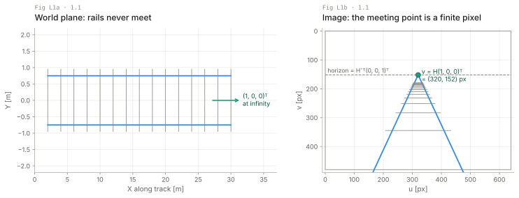
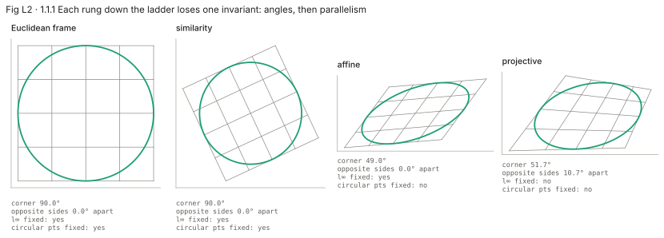
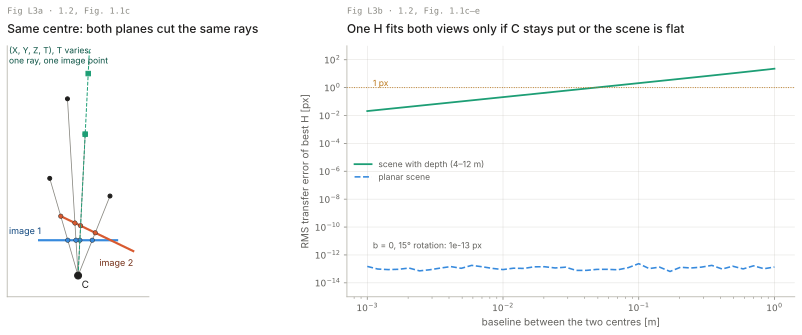
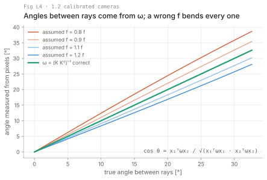
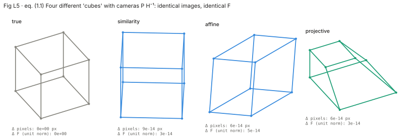
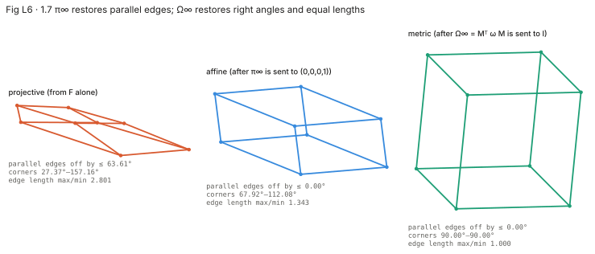

# Lecture: a tour of multiple view geometry

Four layers per must-read section: picture, intuition, formal, your robots. Page and equation numbers are the book's. The chapter is informal by design (p. 1), with two numbered equations and no proofs, so the Formal layers state its claims precisely and point to the chapter that proves them. Every number here comes from `figures/make_figures.py` (`figures/numbers.json`); the synthetic camera has f = 500 px and a 640 × 480 px image.

**Notation warning.** `P` is a 3×4 camera matrix, not a covariance. `H` is a homography (3×3) or a projective transformation of space (4×4), not a measurement Jacobian. `T` is the fourth homogeneous coordinate of (X, Y, Z, T). `ω` is the image of the absolute conic, not an angular rate. H&Z's P = K[R | t] maps world to camera (ch. 6); GTSAM's camera `Pose3` is the camera's pose in the world, the inverse.

---

## L1. Points at infinity are ordinary points (1.1, pp. 1–3)

**Picture.** Rails 1.5 m apart, camera 1.6 m up, pitched 10° down. In the world plane the rails never meet; in the image they meet at v = (320, 152) px, the image of the direction (1, 0, 0)ᵀ.



**Intuition.** Declare (kx, ky, k) the same point for every k ≠ 0 and the triple (x, y, 0) becomes a legal point: a direction. Parallel lines meet there, so two lines always meet. Every map you care about, including ground plane to image, becomes a matrix product, and that matrix may send a point at infinity to a finite pixel. That is the vanishing point.

**Formal.** Homogeneous coordinates (p. 2):

```latex
(kx,\ ky,\ k)^\mathsf{T} \sim (x,\ y,\ 1)^\mathsf{T} \mapsto (x,\ y),\quad k \neq 0; \qquad (x,\ y,\ 0)^\mathsf{T}\ \text{is a point at infinity}
```

ℝⁿ extends to ℙⁿ; the points at infinity form the line at infinity in ℙ² and the plane at infinity in ℙ³. A projective transformation is a non-singular matrix on homogeneous coordinates (p. 3):

```latex
\mathbf{X}' = \mathtt{H}_{(n+1)\times(n+1)}\, \mathbf{X}
```

H is defined up to scale: 8 DoF for 3×3, 15 for 4×4. Euclidean and affine maps keep points at infinity at infinity; a general H does not. In the figure v = H(1, 0, 0)ᵀ with the plane-to-image H of p. 7 (L3), and the horizon is H⁻ᵀ(0, 0, 1)ᵀ because lines map by H⁻ᵀ (eq. 2.6, p. 36). Print slip on p. 3: "the line at infinity in space or the plane at infinity in the image" has the roles swapped.

**Your robots.** On the tracked robot's forward camera the horizon H⁻ᵀ(0, 0, 1)ᵀ moves only with pitch and roll: a free attitude cue, and pixels above it are not floor (p. 4). For the drone, a distant landmark is nearly a point at infinity; (X, Y, Z, T) with T → 0 stays well conditioned where (X/T, Y/T, Z/T) blows up, which is why VIO front ends use inverse-depth or homogeneous landmarks.

---

## L2. The ladder: projective, affine, Euclidean (1.1.1, pp. 3–6)

**Picture.** A square with an inscribed circle through three maps. Similarity: corner 90.0°. Affine: opposite sides still 0.0° apart, corner 49.0°. Projective: corner 51.7°, opposite sides 10.7° apart. The circle survives only the similarity.



**Intuition.** Projective geometry knows lines and incidence only. Pin a line at infinity and "parallel" means "meet on it": affine geometry. Pin two complex points on that line, the circular points, and circles, angles and length ratios exist: Euclidean geometry. In 3D the plane at infinity and the absolute conic Ω∞ on it play those roles. Reconstruction (L5, L6) climbs this ladder in reverse.

**Formal.** A circle in homogeneous coordinates (p. 5):

```latex
(x - aw)^2 + (y - bw)^2 = r^2 w^2
```

(1, ±i, 0)ᵀ gives 1 + i² = 0 for every a, b, r, so the circular points lie on every circle:

```latex
\mathbf{I},\ \mathbf{J} = (1,\ \pm i,\ 0)^\mathsf{T}: \qquad x^2 + y^2 = 0,\ \ w = 0
```

They are the two missing intersections of two circles. A conic has 6 coefficients up to scale, so 5 points fix it; a circle already passes through I and J, so 3 more suffice (p. 5). Every sphere meets the plane at infinity in the absolute conic, which has no real points (p. 6):

```latex
\Omega_\infty:\ X^2 + Y^2 + Z^2 = 0,\ \ T = 0 \qquad\qquad \mathbf{d}_1^\mathsf{T}\,\Omega_\infty\,\mathbf{d}_2 = 0
```

The right-hand relation (p. 6) is perpendicularity: lines with directions d₁, d₂ (3-vectors on the plane at infinity) are perpendicular when the directions are conjugate with respect to Ω∞ (3×3 symmetric). In a Euclidean frame Ω∞ = I and this is the dot product; the general angle is (3.23), p. 82. In the figure, an H counts as affine when it fixes (0, 0, 1)ᵀ as a line, and as a similarity when it also fixes {I, J} (ch. 2).

**Your robots.** An inverse perspective map (bird's-eye view) for the tracked robot's terrain classifier is this ladder: the horizon makes the floor affine, one known right angle and one length ratio make it metric. Converging furrows mean a wrong horizon; parallel furrows with rhombic tiles mean wrong circular points.

---

## L3. The camera is a 3×4 matrix; the centre is what matters (1.2, pp. 6–9)

**Picture.** Left: Fig. 1.1c from above; two image planes through one centre C cut the same rays, and (X, Y, Z, T) with T varying is one ray, one pixel. Right: RMS error of the best-fit homography between two views with a 15° rotation, against baseline. Planar scene: at most 2.4 × 10⁻¹³ px at any baseline. Scene 4–12 m deep: 1 × 10⁻¹³ px at zero baseline, 1 px at 0.048 m, 2.1 px at 0.1 m, 22.75 px at 1 m.



**Intuition.** With the centre at the origin, projection forgets where along the ray a point was: (X, Y, Z, T) ↦ (X, Y, Z). Other centres and pixel frames are coordinate changes, so a general camera is any rank-3 3×4 matrix. A scene plane is a ℙ², so plane-to-image is a 3×3 H. An image is the bundle of rays through C, so two images from one centre differ by a 3×3 H whatever the scene (p. 9). Move C and that fails unless the scene is planar (Fig. 1.1d, e).

**Formal.** Camera at the origin, then the general camera (p. 7):

```latex
\mathtt{P} = [\,\mathtt{I}_{3\times3} \mid \mathbf{0}_3\,] \qquad\qquad (x,\ y,\ w)^\mathsf{T} = \mathtt{P}_{3\times4}\,(X,\ Y,\ Z,\ T)^\mathsf{T},\quad \operatorname{rank}\mathtt{P} = 3
```

Scene on Z = 0: drop the third column of P (p. 7),

```latex
(x,\ y,\ w)^\mathsf{T} = \mathtt{H}_{3\times3}\,(X,\ Y,\ T)^\mathsf{T}, \qquad \mathtt{H} = [\,\mathbf{p}_1\ \mathbf{p}_2\ \mathbf{p}_4\,]
```

Fig. 1.1: x_i = H₃ₓ₃X_i (plane to image) and x′_i = H′₃ₓ₃x_i (same centre). For a pure rotation with one calibration K, H′ = KRK⁻¹ (p. 204); the figure fits H rather than using it. The centre is the null vector, PC = 0; rank 3 makes it unique up to scale.

**Your robots.** A VO initializer that fits only F (L5) fails on the frames Fig. 1.1 warns about: the quadruped turning in place, and a down-looking camera over flat ground. "Nearly" has a number: with 4–12 m depth and f = 500 px, H explains the views to 1 px up to 0.048 m of baseline. ORB-SLAM's initializer (common practice, not the book) fits both H and F and picks by score. Gimbal panoramas on the drone are H′ with C fixed.

---

## L4. Calibration is a conic: ω gives angles (1.2 Calibrated cameras, Example 1.1, pp. 9–10)

**Picture.** Angle between the rays through the image centre and through a pixel on the same row, computed with ω = (KKᵀ)⁻¹. Correct f: the true angle. At the image edge (true 32.62°) an f 20% short reads 6.04° high; 20% long reads 4.55° low.



**Intuition.** Each point of the plane at infinity is a direction, one ray through C, so that plane maps one-to-one onto the image and adds nothing (p. 9). Ω∞ on it maps to an image conic ω, the IAC. Angles between directions are measured against Ω∞, so angles between back-projected rays are measured against ω. Calibrated means ω is known; then one image gives ray angles directly.

**Formal.** Stated in words on p. 9; the formula is eq. (8.9), p. 210, with ω = (KKᵀ)⁻¹ from Result 8.17 on the same page:

```latex
\cos\theta = \frac{\mathbf{x}_1^\mathsf{T}\,\omega\,\mathbf{x}_2}{\sqrt{(\mathbf{x}_1^\mathsf{T}\,\omega\,\mathbf{x}_1)(\mathbf{x}_2^\mathsf{T}\,\omega\,\mathbf{x}_2)}}, \qquad \omega = (\mathtt{K}\mathtt{K}^\mathsf{T})^{-1}
```

x₁, x₂ homogeneous pixels, ω 3×3 symmetric, K 3×3 upper triangular. Example 1.1 (pp. 9–10) is the ladder from one image: vanishing points give a plane's line at infinity (affine), known right angles do the rest (Euclidean), as in Fig. 1.2.

**Your robots.** Every bearing from a pixel is this formula with your K: landmark bearings in the drone's VIO, a RoboCup goal post's angular width, the tracked robot's obstacle rays. A 20% f error costs 6.04° at the edge of this 65° field of view. A lens swap or zoom change without recalibration makes the camera uncalibrated in the book's exact sense.

---

## L5. Two views: everything up to a 4×4 H (1.3, pp. 10–12)

**Picture.** A cube and three transformed "cubes" (similarity, affine, projective), each with cameras P H⁻¹. Largest pixel change: 8.5 × 10⁻¹⁴ px; largest change in unit-norm F: 4.7 × 10⁻¹⁴. The images cannot tell them apart.



**Intuition.** Matches constrain only the products P X, and any invertible 4×4 H slipped between camera and point leaves them unchanged. So uncalibrated matches give at best a projective reconstruction (Fig. 1.4's warped mugs). That is also the worst case: enough points in general position fix the scene up to exactly that (p. 11). The tool is F, 3×3 of rank 2, which H leaves unchanged.

**Formal.** P X_i = x_i, P′ X_i = x′_i (p. 11); for any non-singular 4×4 H,

```latex
\mathtt{P}_j \mathbf{X}_i = (\mathtt{P}_j \mathtt{H}^{-1})(\mathtt{H}\mathbf{X}_i) \qquad (1.1)
```

```latex
\mathbf{x}_i'^{\mathsf{T}}\, \mathtt{F}\, \mathbf{x}_i = 0, \qquad \operatorname{rank}\mathtt{F} = 2\ (\det\mathtt{F} = 0,\ \text{p. 13})
```

Linear in F's 9 entries; 9 − 1 (scale) − 1 (det) = 7, hence at least seven points outside critical configurations (p. 11). F is fixed by P, P′ and fixes them up to H. The outline, p. 12:

| Step | What | Done properly in |
| --- | --- | --- |
| (i) | one linear equation in F per match | ch. 11 |
| (ii) | solve for F | ch. 11; outliers §4.7 |
| (iii) | P, P′ from F | §9.5, p. 253 |
| (iv) | triangulate X_i | ch. 12 |

The book: it "should not be implemented directly from this brief description" (p. 12).

**Your robots.** The drone's cameras are calibrated, so the ambiguity shrinks to a similarity (L6) and the lost piece is scale; the accelerometer recovers it. A GTSAM graph of projection factors with no prior has the same 7-DoF gauge, which is why you anchor a pose and a distance and why unanchored BA drifts in scale.

**Three views, n views, transfer (1.4–1.6, skim).** Three views: the trifocal tensor T_i^{jk} (27 entries) with Σ_{ijk} xⁱ l′_j l″_k T_i^{jk} = 0 (1.2); two lines through each of x′, x″ give 4 equations per triplet, 7 triplets solve it linearly, 6 non-linearly (p. 13). n views: affine factorization by SVD (all points in all views) and bundle adjustment, which can be set up as the ML fit and needs an initial guess (p. 14), which is every SfM and VIO back end. Transfer (p. 16): triangulate from two views, x″ = P″X; with a plane or a pure rotation, a homography from one view.

---

## L6. Climbing back: plane at infinity, then absolute conic (1.7, pp. 16–17)

**Picture.** A projective reconstruction of a cube upgraded twice. Sending π∞ to (0, 0, 0, 1)ᵀ: worst parallel-edge angle 63.61° → 0.00°, corners still 67.92°–112.08°. Sending Ω∞ = MᵀωM to I: corners 90.00°, edge max/min 1.000. The two views agree on Ω∞ to 6.1 × 10⁻¹⁶.



**Intuition.** L2's ladder inside a reconstruction. Ω∞ lies on π∞, so finding Ω∞ is enough. Each calibrated ω_i back-projects to a cone; Ω∞ lies on all of them. Two cones meet in a quartic that splits into two conics, so two views leave two candidates; three views leave one (p. 17). L5's "calibrated ⇒ similarity" is the generic statement; p. 17 is the fine print. Real two-view front ends work with the essential matrix (§9.6), whose four (R, t) candidates are cut to one by requiring the points to lie in front of both cameras (cheirality, ch. 21). Conversely, Euclidean structure projects Ω∞ to each ω_i: calibration and Euclidean reconstruction are the same knowledge.

**Formal.** No equations in the chapter; the figure's two steps in §10.4's form (pp. 267–275):

```latex
\mathtt{H}_A = \begin{bmatrix} [\,\mathtt{I}_{3\times3} \mid \mathbf{0}\,] \\ \boldsymbol{\pi}^\mathsf{T} \end{bmatrix}, \qquad \Omega_\infty = \mathtt{M}^\mathsf{T}\omega\,\mathtt{M} = \mathtt{L}\mathtt{L}^\mathsf{T}, \qquad \mathtt{H}_M = \begin{bmatrix} \mathtt{L}^\mathsf{T} & \mathbf{0} \\ \mathbf{0}^\mathsf{T} & 1 \end{bmatrix}
```

π is the plane at infinity (4-vector, last entry scaled to 1) in the projective frame, M the left 3×3 of an affine-frame camera [M | m], L the Cholesky factor of Ω∞. After H_M perpendicular edges satisfy d₁ᵀd₂ = 0, L2's relation with Ω∞ = I. A global similarity remains.

**Your robots.** This is why you calibrate K offline (Kalibr, checkerboard): the reconstruction starts at the top of the ladder and only scale is left for the IMU. The tracked robot's stereo rig fixes even that, through its known baseline.

**Auto-calibration (1.8, skim).** With no calibration knowledge, projective is the limit (p. 17). With constant unknown calibration, hypothesize ω and require the back-projected cones to meet in one conic; finding π∞ first is the hard step, after which ω follows linearly (p. 18). With square pixels each image gives two rays that must meet Ω∞; 2n rays, and finitely many conics meet 8, so four images suffice up to a finite set (p. 18). Algorithms: ch. 19.

**The rewards (1.9–1.10, skim).** 3D models: projective reconstruction, auto-calibration, dense matching along epipolar lines. Video augmentation: inserting an object needs the Euclidean camera motion, even with varying zoom.

---

## L7. How to tell which model you need

| Symptom | Likely cause | Try |
| --- | --- | --- |
| VO initializer's F is garbage or flips between frames | pure rotation or planar scene, L3 | fit H and F, pick by score; wait for baseline |
| Parallel lines converge in the reconstruction | projective: π∞ unknown, L6 | calibrate K; impose known parallels |
| Parallels fine, right angles wrong | affine: Ω∞ (ω, K) wrong, L6 | recalibrate f, aspect ratio, skew |
| Bearings off, worse toward the image edge | wrong f in ω, L4 | recalibrate (6.04° at the edge for 20% short f here) |
| Map shape right, size drifts | scale unobservable from images, L5 | IMU factors, stereo baseline, scale prior |
| BA diverges or stalls | bad initial guess or free gauge, p. 14 | initialize from F/H + triangulation; anchor pose and scale |
| Panorama seams and ghosting | centre moved between shots, L3 | rotate about the optical centre, or use F |
| Bird's-eye view warps with pitch | stale horizon, L1 | update H from attitude each frame |

Every row is a rung of L2's ladder that the sensor setup left unpinned.
