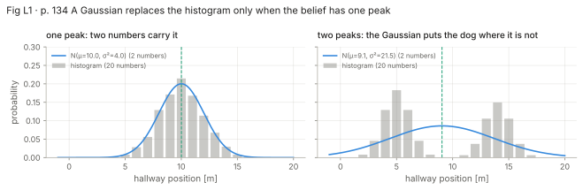
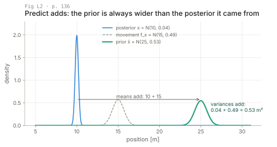
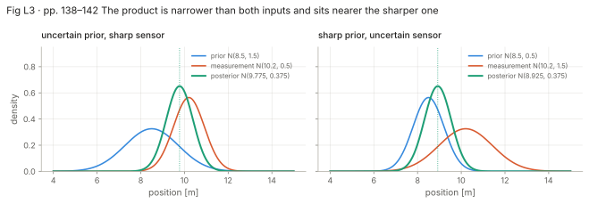
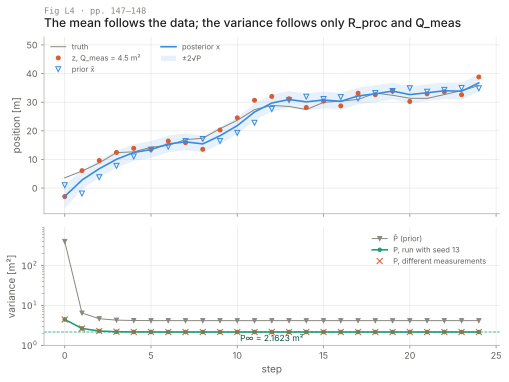
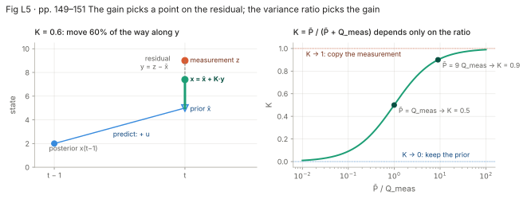
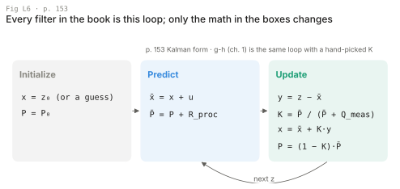
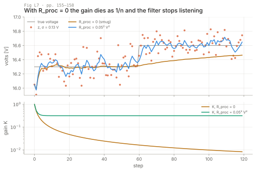
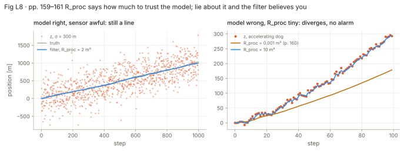
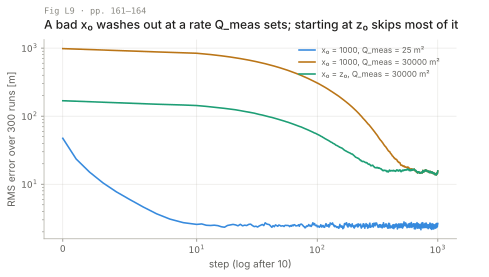
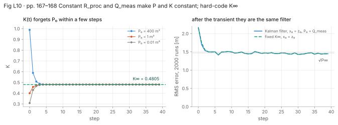

# Lecture: one-dimensional Kalman filters

Four layers per section: picture, intuition, formal, your robots. The chapter is a notebook with no numbered
equations, so citations are by page. Every number below is printed by `figures/make_figures.py`. Code is in
`translate.md`; nothing here solves an exercise.

**Notation warning.** Labbe writes **Q for the process variance and R for the measurement variance** (p. 151, p. 168),
the opposite of Thrun and of this repo. Here `R_proc` = Labbe's `Q` / `process_var` / σ²_fx, `Q_meas` = Labbe's `R` /
`sensor_var` / σ²_z, `P` = belief variance (P̄ for the prior), `u` = known displacement per step.

**Intro, problem description (pp. 131–132), skim:** the dog, the RFID sensor, Gaussian errors. **Beliefs as Gaussians
(pp. 132–133), skip:** covered in ch. 3.

---

## L1. Tracking with Gaussian probabilities (pp. 133–135)

**Picture.** A histogram belief and the two-number Gaussian that replaces it: faithful for one peak, misleading
for two.



**Intuition.** If the belief is "one place, with some spread", a mean and a variance carry all of it, and predict no
longer needs a convolution over bins. The chapter bets that predict and update keep the belief Gaussian; if either did
not, the next step would have nothing to work on (p. 135).

**Formal.** The discrete Bayes filter and its Gaussian stand-in (p. 134):

```latex
\bar{\mathbf x} = \mathbf x * f_{\mathbf x}(\bullet),\quad \mathbf x = \|\mathcal L \bar{\mathbf x}\|
\qquad\longrightarrow\qquad
\bar x_{\mathcal N} = x_{\mathcal N} \oplus f_{x_{\mathcal N}}(\bullet),\quad x_{\mathcal N} = L \otimes \bar x_{\mathcal N}
```

x is a scalar position [m] with belief N(μ, σ²). The guess: ⊕ is a sum of random variables, ⊗ a product of densities.
L2 and L3 confirm both. In the bimodal panel the fitted Gaussian centers at 9.1 m, where the dog almost never is.

**Your robots.** Baro altitude on a drone, encoder distance on a wheel, a gyro bias: one number, one peak, this filter.
A tracked robot that may be in either of two identical corridors is the right panel and needs a histogram or particles.

---

## L2. Predictions with Gaussians (pp. 135–137)

**Picture.** N(10, 0.04) + N(15, 0.49) = N(25, 0.53): means add, variances add.



**Intuition.** Predict shifts the belief by what you think happened and widens it by how unsure you are. It never
narrows. The added variance is per step, so two predicts without a measurement add it twice.

**Formal.** p. 135–136:

```latex
\bar x_k = x_{k-1} + v_k\Delta t = x_{k-1} + f_x, \qquad
\bar\mu = \mu + \mu_{f_x}, \qquad \bar\sigma^2 = \sigma^2 + \sigma_{f_x}^2
```

Kalman form (p. 153): `x̄ = x + u`, `P̄ = P + R_proc`; u [m/step], R_proc [m²/step]. The rule assumes x and f_x are
independent. The book's cell gives N(25.000, 0.530) (p. 137). p. 135 switches the epoch from 2 s (x̄ = 40) to 1 s
(x̄ = 25) between paragraphs; the code uses 1 s.

**Your robots.** Wheel odometry: u = encoder distance, R_proc grows with distance and slip, and on a tracked robot in
sand it is the number you underestimate. Gyro bias: u = 0, R_proc = bias random walk per step.

---

## L3. Updates with Gaussians (pp. 137–138)

**Picture.** The two products of pp. 141–142: the sharper input pulls the posterior toward itself, and the posterior
(0.375 in both panels) is narrower than either input.



**Intuition.** Prior times likelihood keeps the x values both find plausible: a mean weighted by the other input's
variance, and a variance that ignores where the means are (p. 138). That last fact is why P is known before any data
arrives (L4).

**Formal.** p. 138, with σ_z² = Q_meas:

```latex
\mathcal N(\mu,\sigma^2) = \|\mathcal N(\bar\mu,\bar\sigma^2)\cdot\mathcal N(\mu_z,\sigma_z^2)\|
= \mathcal N\!\left(\frac{\bar\sigma^2\mu_z+\sigma_z^2\bar\mu}{\bar\sigma^2+\sigma_z^2},\;
\frac{\bar\sigma^2\sigma_z^2}{\bar\sigma^2+\sigma_z^2}\right)
```

Book cell: `update(N(10, 0.2²), N(11, 0.1²))` = N(10.800, 0.008).

**The derivation in one idea.** The product of two Gaussian densities is a Gaussian times a constant ("proportional",
p. 137). Add the exponents, complete the square; the x-free leftover is N(z; μ̄, σ̄² + σ_z²), the probability of the
measurement under the prior. The chapter normalizes it away. Keep σ̄² + σ_z²: it is the innovation variance S used for
gating and consistency (L8).

**Understanding Gaussian multiplication, interactive example (pp. 139–142), skim.** N(10, 1) × N(10, 1) = N(10, 0.5):
two equal readings halve the variance. The p. 141–142 pair is the figure above. Legends there print the literal
"g2.mean, ge.var"; the orange curve is the second argument.

**Your robots.** A baro update after a second of IMU-only integration moves the estimate almost to the baro; the same
reading right after a lidar fix barely moves it. Same code, decided by two variances.

---

## L4. First Kalman filter and code walkthrough (pp. 142–148)

**Picture.** The 25-step dog of p. 147 (R_proc = 2 m², Q_meas = 4.5 m²) on our own noise. Bottom: P for two runs with
different measurements is identical (maximum difference 0.0) and settles at P∞ = 2.1623 m².



**Intuition.** The first prior is so wide that the first posterior is the measurement; after that the filter averages
prior and measurement, and the posterior always lies between them (p. 145). The variance trace is the same whatever
the dog does, because the variance never sees a mean.

**Formal.** The five lines of p. 147:

| Line | Book code | Package names |
| --- | --- | --- |
| predict 1–2 | `dx = velocity*dt; pos = pos + dx` | `x̄ = x + u` |
| predict 3 | `var = var + process_var` | `P̄ = P + R_proc` |
| update 1 | `pos = (var*z + sensor_var*pos) / (var + sensor_var)` | `x = (P̄z + Q_meas x̄)/(P̄ + Q_meas)` |
| update 2 | `var = (var * sensor_var) / (var + sensor_var)` | `P = P̄Q_meas/(P̄ + Q_meas)` |

With x₀ = N(0, 400) (p. 145), R_proc = 1, Q_meas = 2 (p. 143): first prior 401.000 m², first posterior 1.9901 m²,
P = 1.0000 m² at step 10 (the book prints 1.990 and 1.000). With (2, 4.5), P = 2.1623 m² by step 9, as p. 148 says.

**Plot trap (pp. 147–148).** The yellow band is drawn from `priors[:, 1]`, the prior variance, so it is wider than the
uncertainty of the line it surrounds. Fig L4 bands the posterior.

**Exercise: modify variance values (p. 148).** Which of (R_proc, Q_meas) = (40, 2) or (2, 40) gives the smaller steady
variance? Answer it with L10's quadratic before running anything. **KF animation (pp. 148–149), skip.**

**Your robots.** P not depending on z is what lets you precompute gains offline (L10), and what lets a filter be
confidently wrong (L8).

---

## L5. Kalman gain (pp. 149–151)

**Picture.** The residual chart of p. 150 redrawn, and K as a function of P̄/Q_meas with the book's two worked cases.



**Intuition.** "Prior plus a fraction of the surprise" is the g-h correction with a gain the variances compute.
K → 1 copies the sensor; K → 0 ignores it. Only the variance ratio matters.

**Formal.** Weights W₁ + W₂ = 1, K = W₁ (p. 149), and three equal variance forms (p. 150):

```latex
\mu = K\mu_z + (1-K)\bar\mu = \bar\mu + K(\mu_z-\bar\mu), \qquad K = \frac{\bar\sigma^2}{\bar\sigma^2+\sigma_z^2}
```
```latex
\sigma^2 = \frac{\bar\sigma^2\sigma_z^2}{\bar\sigma^2+\sigma_z^2} = K\sigma_z^2 = (1-K)\bar\sigma^2
```

σ̄² = 9σ_z² gives K = 9/10; σ̄² = σ_z² gives 1/2. Gain-form code (p. 151): `y = z − x; K = P/(P + R); x = x + K*y;
P = (1 − K)*P` with that `R` = Q_meas, and `predict` adds `Q` = R_proc. The chart's label "y = z − −x̄" is y = z − x̄.
In n-D this form generalizes line for line to Thrun's Table 3.1 (the gold package, same lesson t2.2); Labbe defers its derivation
(orthogonal projection, p. 151).

**Your robots.** Log K. A position filter with K stuck near 0.01 runs on its model alone; if the robot is pushed or
slipping, only the residual will show it (L8).

---

## L6. Full description of the algorithm (pp. 152–153)

**Picture.** Initialize, predict, update, repeat; the g-h filter is the same loop with K picked by hand.



**Intuition.** Every filter in the book implements this recipe with different math in the boxes (p. 152). Read each
later filter as a substitution into it.

**Formal.** The tables of p. 153:

| Step | Equation | Implementation | Kalman form |
| --- | --- | --- | --- |
| Predict | x̄ = x + f_x | μ̄ = μ + μ_fx, σ̄² = σ² + σ²_fx | x̄ = x + dx, P̄ = P + R_proc |
| Update | x = ‖ℒx̄‖ | y = z − μ̄, K = σ̄²/(σ̄² + σ_z²), μ = μ̄ + Ky, σ² = σ̄²σ_z²/(σ̄² + σ_z²) | y = z − x̄, K = P̄/(P̄ + Q_meas), x = x̄ + Ky, P = (1 − K)P̄ |

**Your robots.** Opening an unfamiliar estimator (PX4's EKF2, a leg-odometry filter), find these update steps first.

**Comparison with g-h and discrete Bayes (pp. 153–155), skim.** Uniform error bars, a Gaussian, an arbitrary
histogram for one sensor. The histogram models anything and resists analysis; the Gaussian is closed under sum and
product, which is the only reason this chapter has formulas.

---

## L7. Designing a filter: the thermometer (pp. 155–159)

**Picture.** A voltage that steps from 16.3 V to 16.6 V at step 60 (our change; the book keeps it constant). With
R_proc = 0 the gain is 0.0083 by step 120 and the estimate is still 0.136 V low; with R_proc = 0.05² V² the gain holds at
K∞ = 0.3177 and the estimate follows.



**Intuition.** "No movement" means u = 0, not R_proc = 0. With R_proc = 0 the n-th measurement gets weight about 1/n:
the *smug* filter (p. 156). A small R_proc is a forgetting rate.

**Formal.** u = 0, σ_z = 0.13 V, R_proc = 0.05² V², x₀ = N(25, 1000) (p. 156). The book prints "Variance converges to
0.005" (p. 157); the fixed point is 0.00537 V² (`map.md`). With R_proc = 0 the fixed point is P = 0. p. 158 compares
the result with "the 16.4 used by the `volt()` function", but p. 156 sets 16.3 V. Spec sheets (p. 158) give a bound
or a typical value for a product line, not your unit's noise: measure Q_meas on the robot.

**Your robots.** A gyro-bias state with R_proc = 0 "because bias is constant" goes smug within minutes; the bias then
drifts with temperature and the attitude tilts while the covariance says all is well.

---

## L8. Extreme noise and incorrect process variance (pp. 159–161)

**Picture.** Left: σ_z = 300 m, R_proc = 2 m²; the filter is a line on the truth. Right: a dog accelerating by
0.04 m/step², filtered with the book's R_proc = 0.001 m² (amber, 122.3 m behind at the end) and with 10 m² (blue,
7.8 m).



**Intuition.** R_proc is trust in the model. With the right model, trust is free: over the last 500 steps the left
filter's RMS error is 15.06 m against 292.8 m for the raw z, at K∞ = 0.00470. With the wrong model the same trust is
fatal, and the filter cannot tell which case it is in, because P and K never see the data (p. 161).

**Formal.** The check the chapter does not name: NIS = y²/S, S = P̄ + Q_meas (L3's constant), mean 1 for a consistent
scalar filter. Over steps 50–99 on the right, mean NIS is 342.1 with R_proc = 0.001 and 1.82 with R_proc = 10.
The data sees the lie that P hides. The exercises add NIS to this chapter.

**Your robots.** A pose filter tuned with a tiny R_proc so it looks clean in RViz, then pushed by hand: it slides
slowly and its covariance stays small. Plot running NIS next to it; on a tracked robot, slip is what trips it.

---

## L9. Bad initial estimate; large noise and bad initial estimate (pp. 161–164)

**Picture.** RMS error over 300 runs: x₀ = 1000 m with Q_meas = 25 m² (blue) or 30000 m² (amber), and x₀ = z₀ with
30000 m² (teal).



**Intuition.** With a wide P₀ the first gain is large and the initial error mostly vanishes in one step, if the sensor
is decent. With a poor sensor K is small and the error decays by roughly (1 − K) per step. Starting at z₀ swaps a
1000 m error for a σ_z-sized one.

**Formal.** p. 161: P̄ = 502 m², K = 502/527 = 0.95256, so the prior keeps weight 0.047 and the 1000 m error drops to
about 47 m (book: "roughly 50 m"). Steps until RMS < 2√P∞: 6 (blue), 387 (amber), 171 (teal); the book eyeballs
400–600 and "200 or so" (pp. 163–164). p. 161 says the sensor variance is reduced "to 30", but the code sets
`5.**2` = 25 m², as the p. 162 caption says.

**Your robots.** Initialize from the first measurement with P₀ = that sensor's variance: first baro altitude, first
GNSS fix, the dock pose. A small P₀ with a wrong x₀ is the amber curve.

**Exercise: interactive plots (pp. 164–165).** Done in the session. The book's solution uses `sensor_noise` consistently as a
variance, only the name and slider label say noise; the session's sliders are labeled as variances.

**Exercise: nonlinear systems (pp. 165–167), do with care.** The book filters 2 sin(i/3) + noise with
`process_model = N(1, 2)`; the section title and closing paragraph blame nonlinearity, the p. 167 text blames lag.
Three effects are mixed. **Wrong input:** u = +1 m/step that the
signal lacks gives a steady offset u(1 − K∞)/K∞ = +3.41 (R_proc = 2, Q_meas = 30); over 200 seeds the mean offset on
steps 50–99 is +3.36 with u = 1 and −0.05 with u = 0. **Lag:** with u = 0 the track still lags and flattens the sine,
the g-h argument of p. 167. **Wrong sensor variance:** the code says `sensor_var = 30` but draws noise `randn()*1.2`,
variance 1.44 (p. 166). With Q_meas = 1.44, K∞ = 0.673 and the u-offset (1 − K∞)/K∞ falls from 3.41 to 0.48: the
distrust of the sensor multiplies the offset seven times. A sine in time is an unmodeled input, not a nonlinear system; that starts in ch. 9–11.

---

## L10. Fixed gain filters (pp. 167–168)

**Picture.** K(t) from three P₀ converging to K∞ = 0.4805 (R_proc = 2, Q_meas = 4.5), and RMS error over 2000 runs for
the Kalman filter and the fixed gain K∞, both started at z₀.



**Intuition.** With constant R_proc and Q_meas the variance recursion has one stable fixed point, reached from any
P₀ > 0. There the Kalman filter is a constant-gain filter: hard-code K∞ and the update is one multiply-add (p. 167).
You lose only the transient, and starting at z₀ leaves little of it.

**Formal.** Fixed-gain update (p. 168): `K = .13232; y = z − x; x = x + K*y`. Steady state (not in the chapter):
require the update of P̄ = P∞ + R_proc to return P∞:

```latex
P_\infty = \frac{(P_\infty+R_{proc})\,Q_{meas}}{P_\infty+R_{proc}+Q_{meas}}
\;\Longrightarrow\; P_\infty^2 + R_{proc}P_\infty - R_{proc}Q_{meas} = 0,\qquad K_\infty = \frac{P_\infty}{Q_{meas}}
```

K∞ = P∞/Q_meas is p. 150's σ² = Kσ_z². K∞ for the chapter's filters: dog p. 143, 0.50000; thermometer, 0.31770;
extreme noise, 0.00470; incorrect process variance, 0.00705; bad initial estimate, 0.24566; large noise, 0.00813.
On the right panel the mean RMS over steps 20–39 is 1.455 m for both, against √P∞ = 1.470 m. The book's 0.13232 is
presented as "the dog tracking filter" (p. 167) with an "experimentally derived" gain (p. 168), yet it matches none of
these, including both dog filters; an exercise asks what ratio gives it.

**Your robots.** A complementary filter is a fixed-gain Kalman filter with K set by feel; this sets it from two
variances. On a fixed-point MCU, store K∞ as a constant, and recompute it when the loop rate changes, because R_proc is
per step.

---

**FilterPy's implementation (pp. 168–169), skim.** `kf.predict(x, P, u, Q)`, `kf.update(x, P, z, R)`, with `Q` =
R_proc and `R` = Q_meas; use keywords, the third positional argument is not `u` (p. 168). Oracles:
`predict(x=10, P=3, u=1, Q=4)` = (11, 7); then `update(z=12, R=3.5²)` = (11.364, 4.455) (p. 169).
**Summary (p. 170), skim:** pick a value between prediction and measurement, weighted by their variances.

---

## L11. How to tell what is wrong with your 1-D filter

| Symptom | Likely cause | Try |
| --- | --- | --- |
| Smooth estimate drifting off the data; NIS mean ≫ 1 | R_proc too small for the real motion (p. 160) | raise R_proc until NIS ≈ 1; add the missing input or a velocity state (ch. 6) |
| K decays toward 0, real changes ignored | R_proc = 0: smug filter (p. 156) | small nonzero R_proc from the expected change per step |
| Estimate as noisy as z; NIS mean ≪ 1 | R_proc too large or Q_meas too small | measure Q_meas with the sensor at rest; lower R_proc |
| Constant offset that never decays | biased u: velocity, wheel radius, slip (pp. 165–167) | fix u, or estimate the bias as a state (ch. 6) |
| Lags a moving signal, flattens peaks | no dynamics for the motion; K small | larger R_proc, or velocity in the state |
| Long transient after start | bad x₀ with large Q_meas (pp. 162–163) | x₀ = z₀, P₀ = Q_meas |
| Too confident or too loose by about a square | σ passed where a variance is expected (a datasheet σ used as σ²) | square σ; name variables `*_var` |
| Fixed-gain filter off after a firmware change | Δt changed, so R_proc per step and K∞ changed | recompute K∞ (L10) |

Only the ratio of R_proc to Q_meas sets K∞; the session puts both on sliders with NIS as the readout.
