# Lecture: a micro Lie theory

Each section is taught in four layers: the picture, the intuition, the formal statement, and where it meets your
robots. Equation numbers and page numbers are the paper's (PDF page = printed page). Every number quoted below comes
from `figures/make_figures.py` (written to `figures/numbers.json`). That script uses scipy's `expm`/`logm` for Exp and
Log, the generic definition (31) for Ad, and central finite differences of (41a) for every Jacobian, so the closed
forms you implement in the exercises are checked against it rather than copied from it. Code cards are in
`translate.md`; nothing here is a solution to an exercise.

**Notation warning (whole paper).** Three conventions differ from the rest of the repo.

- *Perturbation side.* This paper perturbs on the right, 𝒳 = 𝒳̄ ⊕ τ = 𝒳̄ Exp(τ), so τ lives in the body frame. Barfoot
  (ch. 8, same lesson t2.6) perturbs on the left, T = exp(ξ^) T̄, so ξ lives in the world frame. His Jacobian 𝒥 is
  this paper's J_l. The bridge is (75) and, for SO(3), (147) J_l = J_rᵀ.
- *Tangent order.* SE(2) and SE(3) tangents are τ = (ρ, θ), translation first (153), (169), as in Barfoot and manif.
  GTSAM's Pose3 puts rotation first, (ω, v). Ex. 7 prints the SE(n) tangent as (θ, ρ), which disagrees with (153) and (169).
- *Noise names.* The paper calls process noise **W** (93) and measurement noise **N** (96). In code they are `R_proc`
  (Thrun's R) and `Q_meas` (Thrun's Q). **R** is always a rotation matrix in this paper, never a covariance.

---

## I. Introduction (skim, pp. 1–2)

The paper keeps the group, the exponential map, the adjoint and the Jacobians, and drops the Lie bracket. It also
pushes the Lie algebra 𝔪 into the background: every operator is written on the coordinate vector τ ∈ ℝᵐ, and τ^ ∈ 𝔪
appears only inside definitions. Covariances, increments and Jacobians are therefore ordinary vectors and matrices of
size m = dof. If you need the bracket or BCH, read Barfoot §8.1.2 and §8.1.5. The paper's C++ library manif is ref. [7]
and is the reference implementation for the cards.

---

## L1. The Lie group (II-A)

**Picture.** The unit circle S¹ from Ex. 1. Composition rotates you along the circle (θ₁ + θ₂), and the tangent line
at the identity (teal, solid) is a copy of the tangent line at any other point (teal, dashed).

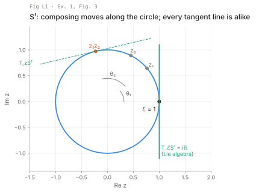

**Intuition.** A Lie group is a curved surface where every point is also an operation. Two facts make it usable for
estimation. First, composing two elements never leaves the surface, so a rotation times a rotation is still a
rotation and needs no renormalizing beyond round-off. Second, the surface looks the same from every point. One tangent
space, the one at the identity, is therefore enough to describe all of them.

**Formal.** (𝒢, ∘) with closure (1), identity ℰ (2), inverse 𝒳⁻¹ (3) and associativity (4):

```latex
\mathcal X\circ\mathcal Y\in\mathcal G \quad(1)\qquad
\mathcal E\circ\mathcal X=\mathcal X\circ\mathcal E=\mathcal X \quad(2)\qquad
\mathcal X^{-1}\circ\mathcal X=\mathcal X\circ\mathcal X^{-1}=\mathcal E \quad(3)
```

A smooth manifold has no edges or spikes, so it has a unique tangent space T_𝒳ℳ at every point (Fig. 2). The two
examples to keep in mind are S¹, the unit complex numbers z = cos θ + i sin θ (1 DoF, Ex. 1), and S³, the unit
quaternions q = cos(θ/2) + u sin(θ/2) (3 DoF, Ex. 2). Both carry an inverse that is just the conjugate.

**Your robots.** Each state component on the robots is one of these groups. The tracked robot's heading is S¹/SO(2).
The drone's and quadruped's attitudes are S³ or SO(3), and their full body poses are SE(3). What the group structure
removes is the "renormalize the quaternion after the update" step. That step exists only because an additive update
q + δq leaves S³, and (1) says a composition q ∘ Exp(δθ) cannot.

---

## L2. The group actions (II-B)

**Picture.** An SE(2) element acts on a set of planar points (the gray triangle v). Acting with 𝒴 and then 𝒳 gives the
same points as acting once with 𝒳∘𝒴. The largest gap in this run is 2.2 × 10⁻¹⁶ m.

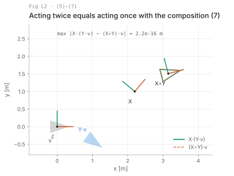

**Intuition.** Groups are useful because they move other things: points, vectors, landmarks. An action is how a pose
transforms a landmark from its own frame into the parent frame. The compatibility axiom says that chaining transforms
and transforming in sequence agree. That is the property you rely on whenever you write T_world_cam = T_world_body ∘
T_body_cam.

**Formal.** 𝒳 · v with 𝒳 ∈ ℳ, v ∈ 𝒱 (5); identity ℰ · v = v (6); compatibility (𝒳∘𝒴)·v = 𝒳·(𝒴·v) (7). The four
actions used throughout (p. 3):

| Group | Action | Shapes |
| --- | --- | --- |
| SO(n) | R · x = R x | R n×n, x ∈ ℝⁿ |
| SE(n) | H · x = R x + t | H (n+1)×(n+1) |
| S¹ | z · x = z x | x a complex number |
| S³ | q · x = q x q* | x a pure quaternion |

The S³ action uses q twice, which is why a rotation by θ has the half angle θ/2 inside q (Ex. 2, Ex. 5).

**Your robots.** The beacon model of §V, y = 𝒳⁻¹ · b, is an SE(2) action with the inverse pose. The same structure gives
the drone camera's projection of a map point, T_cam_world · p_world, before the pinhole. In 3-D the action Jacobians
(150), (166), (182) are the blocks you will use most often.

---

## L3. Tangent spaces and the Lie algebra (II-C)

**Picture.** A point spins around S¹ at constant ω (Fig. 5). Seen from the origin, its velocity ż (coral) turns with
it. Seen from the moving point, z⁻¹ż (teal) is the same number iω at every instant. Over a full turn the local velocity
varies by 3.9 × 10⁻¹⁶ in this run.

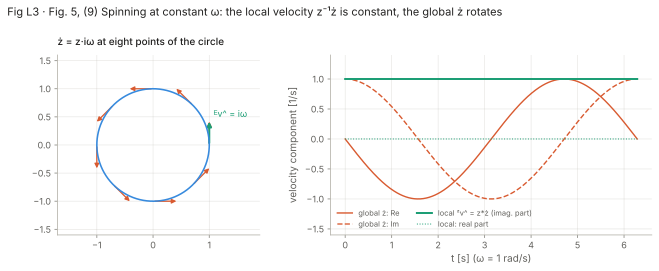

**Intuition.** Differentiating the constraint that defines the group, such as RᵀR = I or q*q = 1, tells you what a
velocity can look like. The answer is that 𝒳⁻¹Ẋ always has the same structure (skew-symmetric, imaginary, pure
quaternion), wherever you are on the group. That common structure is the Lie algebra. It is a vector space with m
dimensions, so you stop working with matrices and work with an m-vector of coordinates instead.

**Formal.** The Lie algebra is the tangent space at the identity (8), and velocities pulled back to it read (9):

```latex
\mathfrak m \triangleq T_{\mathcal E}\mathcal M \qquad (8)
\qquad\qquad
\mathbf v^\wedge = \mathcal X^{-1}\dot{\mathcal X} = -\dot{\mathcal X^{-1}}\,\mathcal X \qquad (9)
```

Hat and vee are the linear isomorphisms between ℝᵐ and 𝔪 through the generators E_i (10)–(11):

```latex
\boldsymbol\tau^\wedge=\sum_{i=1}^m\tau_i E_i \quad (10)\qquad (\boldsymbol\tau^\wedge)^\vee=\boldsymbol\tau=\sum_i\tau_i\mathbf e_i \quad (11)
```

For SO(3) (Ex. 3): RᵀṘ = [ω]ₓ, with [ω]ₓ the 3×3 skew matrix of ω ∈ ℝ³ and generators E_x, E_y, E_z. Table I lists
the sizes, which are not the dimensions: SO(3) is stored in 9 numbers and has m = 3, SE(3) in 16 numbers with m = 6,
S³ in 4 numbers with m = 3. A left superscript names the tangent space a vector lives in: ˣv ∈ T_𝒳ℳ, ᴱv ∈ T_ℰℳ.

**Your robots.** A gyro measures ω in the body frame, which is ˣω, the right-hand (local) tangent. That is why the
drone's attitude update in L9 multiplies on the right. A vehicle twist (v, ω) from wheel odometry is an element of
𝔰𝔢(2) in the body frame as well, and §V uses it that way in (92).

---

## L4. The exponential map (II-D)

**Picture.** Left: the truncated series (16) for SO(3) against `expm`. At θ = 0.5, 1.5 and 3.0 rad it needs powers up to
11, 17 and 23 to reach 10⁻¹² in this run. Right: on SO(2), Log(Exp(θ)) returns θ only on (−π, π]. Outside that interval
it wraps, and the wrap shows at θ = ±π.

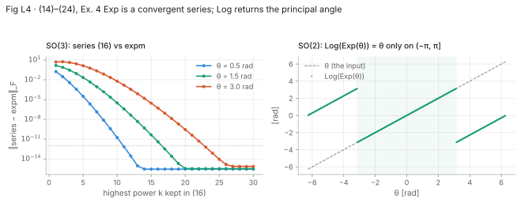

**Intuition.** Exp takes a constant velocity applied for unit time and returns where it ends up on the group. It wraps
a straight line from the tangent plane onto the surface along a geodesic, like string wound around a ball. Log
unwraps: it gives the shortest tangent vector that reaches a given element. For rotations, Log has a branch cut at π,
so two rotations more than π apart have no unique "difference".

**Formal.** For constant v the ODE (12) Ẋ = 𝒳 v^ integrates to (13) 𝒳(t) = 𝒳(0) exp(v^t). With τ = vt (a velocity
times a time, τ ∈ ℝᵐ):

```latex
\exp:\ \mathfrak m\to\mathcal M,\ \boldsymbol\tau^\wedge\mapsto\mathcal X=\exp(\boldsymbol\tau^\wedge) \quad(14)
\qquad
\exp(\boldsymbol\tau^\wedge)=\mathcal E+\boldsymbol\tau^\wedge+\tfrac12\boldsymbol\tau^{\wedge 2}+\tfrac1{3!}\boldsymbol\tau^{\wedge3}+\cdots \quad(16)
```

Properties (17)–(20). The one that matters most is (20), which moves a group element through the exponential:

```latex
\exp(\mathcal X\boldsymbol\tau^\wedge\mathcal X^{-1})=\mathcal X\exp(\boldsymbol\tau^\wedge)\mathcal X^{-1} \qquad (20)
```

The capitalized Exp and Log (21)–(24) go directly between ℝᵐ and ℳ: Exp(τ) = exp(τ^), Log(𝒳) = log(𝒳)^∨.

**The derivation in one idea (Ex. 4).** For SO(3), write θ = uθ with ‖u‖ = 1. The powers of [u]ₓ cycle with period
two: [u]ₓ³ = −[u]ₓ and [u]ₓ⁴ = −[u]ₓ². The series (16) therefore collapses into I, [u]ₓ times the sine series and
[u]ₓ² times the (1 − cosine) series, which is Rodrigues (134). The same trick on pure quaternions, where u² = −1, gives
Euler's formula q = cos(θ/2) + u sin(θ/2) (Ex. 5, (132)). The half angle comes from the hat of S³ being θ/2.

**Your robots.** Exp is how the drone integrates a gyro sample (L9). Log is how you compute an attitude error for a
controller or a residual, and its branch cut is why a yaw-error controller written as `yaw_ref − yaw` spins the robot
the long way round unless you wrap the difference.

---

## L5. Plus and minus (II-E)

**Picture.** The same τ = (1.2 m, 0 m, 0.9 rad) applied to the same pose 𝒳 in two ways. Right-⊕ (teal) drives the
robot forward in its own frame. Left-⊕ (coral, dashed) moves it in the world frame about the world origin. In this run
the two end positions are 0.42 m apart.

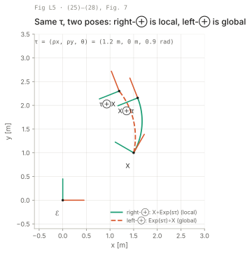

**Intuition.** ⊕ and ⊖ make a curved state look like a vector: "state plus increment" and "state minus state" give
back an m-vector. The group does not commute, so it matters which side the increment goes on. On the right, the
increment is expressed in the local frame at 𝒳. On the left, it is expressed in the global frame at ℰ. The paper uses
the right versions throughout, and so does this package.

**Formal.**

```latex
\mathcal Y=\mathcal X\oplus{}^{\mathcal X}\!\boldsymbol\tau\triangleq\mathcal X\circ\mathrm{Exp}({}^{\mathcal X}\!\boldsymbol\tau) \quad (25)
\qquad
{}^{\mathcal X}\!\boldsymbol\tau=\mathcal Y\ominus\mathcal X\triangleq\mathrm{Log}(\mathcal X^{-1}\circ\mathcal Y) \quad (26)
```

```latex
\mathcal Y={}^{\mathcal E}\!\boldsymbol\tau\oplus\mathcal X\triangleq\mathrm{Exp}({}^{\mathcal E}\!\boldsymbol\tau)\circ\mathcal X \quad (27)
\qquad
{}^{\mathcal E}\!\boldsymbol\tau=\mathcal Y\ominus\mathcal X\triangleq\mathrm{Log}(\mathcal Y\circ\mathcal X^{-1}) \quad (28)
```

The ⊖ symbol is ambiguous between (26) and (28); the paper means (26) unless it says otherwise (p. 6).

**Notation warning.** Footnote 3 fixes the frame convention as ᴳx = R ᴸx: R maps local vectors to global ones, as in
T_world_body. Ref. [9] uses the opposite convention. Barfoot's T_vk,i maps world to vehicle, also the opposite. Check
which way round a T is before you put it next to an ⊕.

**Your robots.** The ESKF error state on every robot is a right-⊕ increment: δx = 𝒳 ⊖ 𝒳̂ (97), body-frame attitude and
position errors. FAST-LIO2's ⊞ on SO(3), R Exp(r), is the same right-⊕. A left-⊕ filter (world-frame errors, Barfoot's convention) is equally valid,
but you cannot mix a covariance from one with a Jacobian from the other. L6 gives the conversion.

---

## L6. The adjoint (II-F)

**Picture.** The local increment ˣτ = (1.20, 0.00, 0.90) applied on the right (thick teal) and the global increment
ᴱτ = Ad_𝒳 ˣτ = (1.50, −0.31, 0.90) applied on the left (blue, dashed) trace the same path. The largest gap along the
path in this run is 1.0 × 10⁻¹⁵. Applying ˣτ on the left without Ad (gray, dotted) misses.

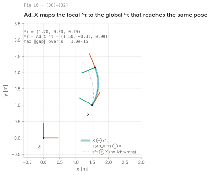

**Intuition.** Ad_𝒳 rewrites a tangent vector from the frame at 𝒳 into the frame at the identity. It is a plain m×m
matrix, so it converts increments, velocities and covariances between local and global with a single product. For
rotations it is the rotation itself (Ad_R = R, (139)). For poses it also mixes in the lever arm, [t]ₓR in SE(3).

**Formal.** From (20), (25) and (27), ᴱτ^ = 𝒳 ˣτ^ 𝒳⁻¹. That defines the adjoint (29) and its matrix (30)–(31):

```latex
\mathrm{Ad}_{\mathcal X}(\boldsymbol\tau^\wedge)\triangleq\mathcal X\boldsymbol\tau^\wedge\mathcal X^{-1}\quad(29)
\qquad
{}^{\mathcal E}\!\boldsymbol\tau=\mathbf{Ad}_{\mathcal X}\,{}^{\mathcal X}\!\boldsymbol\tau\quad(30)
\qquad
\mathbf{Ad}_{\mathcal X}\boldsymbol\tau=(\mathcal X\boldsymbol\tau^\wedge\mathcal X^{-1})^\vee\quad(31)
```

```latex
\mathcal X\oplus\boldsymbol\tau=(\mathbf{Ad}_{\mathcal X}\boldsymbol\tau)\oplus\mathcal X\quad(32)\qquad
\mathbf{Ad}_{\mathcal X^{-1}}=\mathbf{Ad}_{\mathcal X}^{-1}\quad(33)\qquad
\mathbf{Ad}_{\mathcal X\mathcal Y}=\mathbf{Ad}_{\mathcal X}\mathbf{Ad}_{\mathcal Y}\quad(34)
```

Ad_𝒳 is m×m. In (33)–(34) the left-hand sides are cheaper to compute than the right-hand ones, so build Ad of the
inverse directly instead of inverting a 6×6 matrix (p. 7).

**The derivation in one idea (Ex. 6).** Apply (31) to the basis vectors: conjugate τ^ by M, read the result back with
vee, and collect terms. For SE(3) this gives Ad_M = [[R, [t]ₓR], [0, R]] (175). It uses only [Rθ]ₓ = R[θ]ₓRᵀ and
[a]ₓb = −[b]ₓa. The SE(2) form (159) follows the same way.

**Your robots.** Ad converts an IMU's angular velocity to another frame on the quadruped. It also moves a covariance
expressed in the body frame of FORGE's pose node to the world frame for display, via (54).

---

## L7. Derivatives on Lie groups (II-G)

**Picture.** Take f(𝒳) = 𝒳⁻¹ · b, the beacon measurement of §V. Compute its right Jacobian J by finite differences of
(41a), then plot ‖f(𝒳 ⊕ τ) − f(𝒳) − Jτ‖ against ‖τ‖ in six random directions. The fitted slope is 2.00 in all six. A
wrong J leaves a first-order residual (dotted line, slope 1).

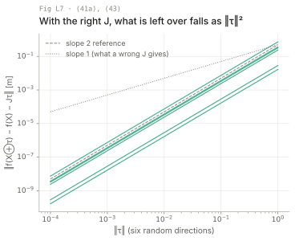

**Intuition.** The vector-space derivative "(f(x + h) − f(x)) / h" carries over to groups unchanged once + becomes ⊕
on the input side and − becomes ⊖ on the output side. The resulting Jacobian maps a small step in the tangent at 𝒳 to
a small step in the tangent at f(𝒳). It is an ordinary n×m matrix, so the EKF and Gauss-Newton formulas apply to it
unchanged. The slope test in the figure is also the check you run on every Jacobian in this package.

**Formal.** For f: ℳ → 𝒩, with m = dim ℳ and n = dim 𝒩:

```latex
\frac{{}^{\mathcal X}Df(\mathcal X)}{D\mathcal X}\triangleq\lim_{\boldsymbol\tau\to0}\frac{f(\mathcal X\oplus\boldsymbol\tau)\ominus f(\mathcal X)}{\boldsymbol\tau}
=\left.\frac{\partial\,\mathrm{Log}\big(f(\mathcal X)^{-1}\circ f(\mathcal X\circ\mathrm{Exp}(\boldsymbol\tau))\big)}{\partial\boldsymbol\tau}\right|_{\boldsymbol\tau=0}\in\mathbb R^{n\times m}\quad(41a,c)
```

```latex
f(\mathcal X\oplus{}^{\mathcal X}\!\boldsymbol\tau)\xrightarrow[{}^{\mathcal X}\boldsymbol\tau\to0]{} f(\mathcal X)\oplus\frac{{}^{\mathcal X}Df(\mathcal X)}{D\mathcal X}\,{}^{\mathcal X}\!\boldsymbol\tau \qquad (43)
```

Column i is σ_i(h)/h with σ_i(h) = f(𝒳 ⊕ h e_i) ⊖ f(𝒳) (42), the directional derivative along e_i (Fig. 8). The worked
example on p. 8 gives, for f(R) = Rp on SO(3), the derivative −R[p]ₓ. The left Jacobian (44) uses left-⊕/⊖ and maps
global tangents to global tangents. Left and right Jacobians are related by the adjoints (46):

```latex
\frac{{}^{\mathcal E}Df(\mathcal X)}{D\mathcal X}\,\mathbf{Ad}_{\mathcal X}=\mathbf{Ad}_{f(\mathcal X)}\,\frac{{}^{\mathcal X}Df(\mathcal X)}{D\mathcal X} \qquad (46)
```

The crossed Jacobians (47)–(50) map local to global or the reverse. They are only a pointer here; Fig. 9 shows every
map at once. From III on the paper writes J^{f(𝒳)}_𝒳 for a right Jacobian.

**Your robots.** `just fd module:func` runs the check in this figure on any Jacobian you write. When a leg-odometry
Jacobian on the quadruped fails it, look first for ⊖ taken on the wrong side: a local Jacobian used where the filter
expects a global one.

---

## L8. Uncertainty and covariance propagation (II-H)

**Picture.** A Gaussian in the tangent at 𝒳̄ (σ_ρ = 0.10 m, σ_θ = 0.25 rad) is pushed to a point 3 m ahead of the robot.
The Monte Carlo cloud (gray) bends into a banana. In this run, 73.9 % of the cloud falls inside the 2σ ellipse from
(55), against 86.5 % for a true Gaussian, and the cloud's mean sits at x = 2.91 m instead of 3.00 m.

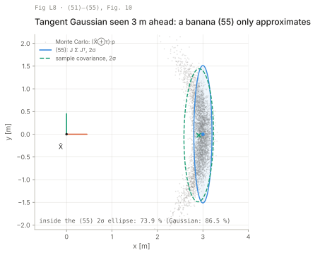

**Intuition.** A covariance needs a vector to describe. On a group that vector is the tangent perturbation τ, not the
group element, so Σ is m×m: 3×3 for an SE(2) pose and 6×6 for SE(3), never 9×9 or 16×16. Propagation through a
function is then J Σ Jᵀ, exactly as in a vector space. It is exact only to first order, and the error shows up as the
banana once angular uncertainty and lever arm grow together.

**Formal.** Local perturbation (51), covariance on the tangent (52), global version (53) and conversion (54):

```latex
\mathcal X=\bar{\mathcal X}\oplus\boldsymbol\tau,\ \ \boldsymbol\tau=\mathcal X\ominus\bar{\mathcal X}\in T_{\bar{\mathcal X}}\mathcal M\quad(51)
\qquad
\boldsymbol\Sigma_{\mathcal X}\triangleq\mathbb E[\boldsymbol\tau\boldsymbol\tau^\top]=\mathbb E[(\mathcal X\ominus\bar{\mathcal X})(\mathcal X\ominus\bar{\mathcal X})^\top]\in\mathbb R^{m\times m}\quad(52)
```

```latex
{}^{\mathcal E}\boldsymbol\Sigma_{\mathcal X}=\mathbf{Ad}_{\mathcal X}\,{}^{\mathcal X}\boldsymbol\Sigma_{\mathcal X}\,\mathbf{Ad}_{\mathcal X}^\top\quad(54)
\qquad
\boldsymbol\Sigma_{\mathcal Y}\approx\frac{Df}{D\mathcal X}\boldsymbol\Sigma_{\mathcal X}\frac{Df}{D\mathcal X}^{\!\top}\in\mathbb R^{n\times n}\quad(55)
```

Footnote 5 explains why the naive E[(𝒳 − 𝒳̄)(𝒳 − 𝒳̄)ᵀ] is ill-defined: size(𝒳) > dim(ℳ), so that matrix is singular.
The p. 9 example is a global covariance diag(σ_φ², σ_θ², ∞) for an attitude known up to yaw, which only makes sense in
the global frame (53).

**Your robots.** The tracked robot's pose covariance from the localizer is 3×3 in (ρ, θ), not in (x, y, θ). The
difference is the V(θ) of L18, small for a small θ spread but not negligible after a long dead-reckoned turn. The
banana in the figure is what you see when a robot with a poor heading estimate projects a LiDAR return or a planned
waypoint several meters ahead.

---

## L9. Discrete integration on manifolds (II-I)

**Picture.** A constant twist (v = 1 m/s, ω = 0.5 rad/s) integrated for 9 s at δt = 1.5 s. Exp integration (56) lands on
the true circle with an end-point error of 4.4 × 10⁻¹⁶ m. Euler on (x, y, θ) cuts outside it and ends 1.18 m off; at
δt = 0.1 s Euler is still 0.078 m off.

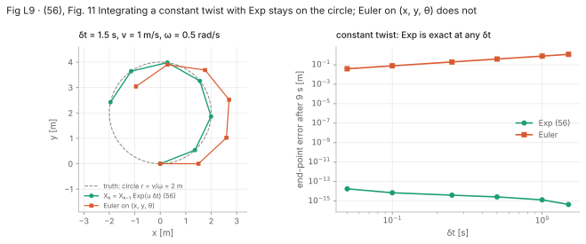

**Intuition.** Exp is the exact integral of a constant velocity in the body frame. Applying it step after step is
exact whenever the velocity is piecewise constant, however coarse the step. Euler on (x, y, θ) assumes the heading
stays fixed during the step, so it drives along the tangent at the start of the step while the heading keeps changing.

**Formal.** Piecewise-constant v_k over δt_k, with the local steps τ_k = v_k δt_k (Fig. 11):

```latex
\mathcal X_k=\mathcal X_{k-1}\oplus\boldsymbol\tau_k=\mathcal X_{k-1}\circ\mathrm{Exp}(\boldsymbol\tau_k)=\mathcal X_{k-1}\circ\mathrm{Exp}(\mathbf v_k\delta t_k) \qquad (56)
```

Examples on p. 9: R_k = R_{k−1} Exp(ω_k δt) and q_k = q_{k−1} Exp(ω_k δt).

**Misprint.** The expansion above (56) writes 𝒳₀ ∘ Exp(v₁δt₁) ∘ Exp(v₁δt₂) ∘ ⋯. The second factor should be Exp(v₂δt₂).

**Your robots.** The drone's attitude propagation from the gyro is exactly R_k = R_{k−1} Exp(ω δt). On the tracked
robot, the same SE(2) Exp of the odometry twist replaces the textbook (x, y, θ) Euler step, and that removes the drift
the figure shows during tight turns. The robot's real velocity is not constant within a step, though, so you still need
a short δt to follow it.

---

## III intro (p. 9)

For every group there are closed forms for four elementary Jacobians: inversion, composition, exponentiation and
action. The Log, ⊕ and ⊖ Jacobians follow from them, and the chain rule builds everything else. Every Jacobian in the
paper is a right Jacobian; the left ones follow from (57), J^E = Ad_{f(𝒳)} J^X Ad_𝒳⁻¹, with Ad_𝒳⁻¹ computed as
Ad_{𝒳⁻¹} (33).

---

## L10. The chain rule (III-A)

**Picture.** The measurement Jacobian H of §V-A, computed three times by finite differences: once for the whole
function and once for each of the two blocks. The product of the two blocks equals the whole to 7 × 10⁻¹⁰, which is
finite-difference noise. The paper's printed H = −[I  Rᵀ[1]ₓ(b − t)] matches the same finite difference to
2.9 × 10⁻¹⁰ at this pose.

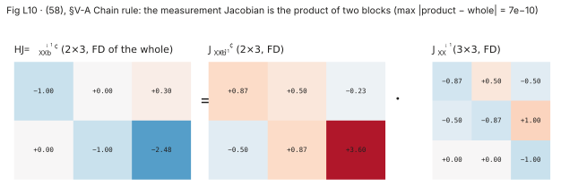

**Intuition.** Right Jacobians are linear maps between tangent spaces. Composing functions composes the maps, so you
multiply the Jacobians in the same order you would in ℝⁿ. Once you have a small table of blocks, every model
Jacobian is a product of entries from that table. The proof is three applications of the linearization (43).

**Formal.**

```latex
\frac{D\mathcal Z}{D\mathcal X}=\frac{D\mathcal Z}{D\mathcal Y}\frac{D\mathcal Y}{D\mathcal X}
\quad\text{or}\quad
\mathbf J^{\mathcal Z}_{\mathcal X}=\mathbf J^{\mathcal Z}_{\mathcal Y}\mathbf J^{\mathcal Y}_{\mathcal X} \qquad (58)
```

When left, right and crossed Jacobians are mixed, the reference frames must also chain, (59)–(60): an ᴱ superscript on
one factor must meet an ᴱ subscript on the next. The figure's example is
H = J^{𝒳⁻¹·b}_{𝒳⁻¹} J^{𝒳⁻¹}_𝒳, a 2×3 action block (166) evaluated at 𝒳⁻¹ times the 3×3 inverse block (62).

**Your robots.** Write each robot's measurement model as a chain of these blocks. FORGE's custom factors (wheel
odometry, a GNSS antenna lever arm, a camera extrinsic) are each two or three of them. Test the full Jacobian once
with `just fd`, then test each block in its own unit test, so that a failure points to the block that broke.

---

## L11. Elementary Jacobian blocks (III-B)

**Picture.** For SE(2), the finite-difference Jacobians of inversion and composition (top) match the adjoint formulas
(bottom). The largest differences are 2 × 10⁻¹⁰, 9 × 10⁻¹¹ and 1 × 10⁻¹⁰. In the same run (75) and (76) hold to
1.0 × 10⁻¹⁰ and 1.5 × 10⁻¹⁰.

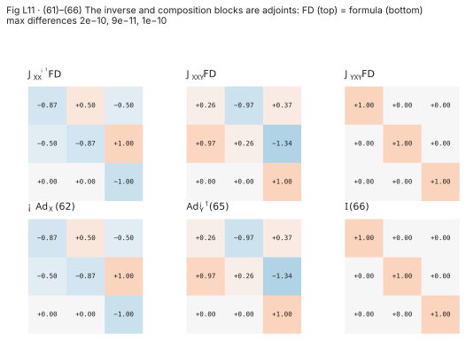

**Intuition.** Inverting or composing moves the base point. The derivative is then an adjoint, which re-expresses the
perturbation in the frame of the new base point. Exp has a nontrivial Jacobian of its own, J_r. It answers the
question "if I nudge τ, how does Exp(τ) move, seen in the local frame at Exp(τ)?" Near τ = 0 it is the identity, and it
moves away from the identity as τ grows.

**Formal.** All blocks are m×m.

| Block | Result | Eq. |
| --- | --- | --- |
| Inverse J^{𝒳⁻¹}_𝒳 | −Ad_𝒳 | (62) |
| Composition J^{𝒳∘𝒴}_𝒳 | Ad_𝒴⁻¹ | (65) |
| Composition J^{𝒳∘𝒴}_𝒴 | I | (66) |
| Right Jacobian of ℳ, J_r(τ): right Jacobian (41a) of Exp | per group, App. A–E | (67) |
| Left Jacobian of ℳ, J_l(τ): left Jacobian (44) of Exp | per group | (71) |
| Action J^{𝒳·v}_𝒳, J^{𝒳·v}_v | per group | (77)–(78) |

What J_r is for (68)–(70), and its left twins (72)–(74):

```latex
\mathrm{Exp}(\boldsymbol\tau+\delta\boldsymbol\tau)\approx\mathrm{Exp}(\boldsymbol\tau)\,\mathrm{Exp}(\mathbf J_r(\boldsymbol\tau)\delta\boldsymbol\tau)\ (68)
\qquad
\mathrm{Log}(\mathrm{Exp}(\boldsymbol\tau)\mathrm{Exp}(\delta\boldsymbol\tau))\approx\boldsymbol\tau+\mathbf J_r^{-1}(\boldsymbol\tau)\delta\boldsymbol\tau\ (70)
```

```latex
\mathbf{Ad}_{\mathrm{Exp}(\boldsymbol\tau)}=\mathbf J_l(\boldsymbol\tau)\,\mathbf J_r^{-1}(\boldsymbol\tau)\quad(75)
\qquad
\mathbf J_r(-\boldsymbol\tau)=\mathbf J_l(\boldsymbol\tau)\quad(76)
```

**The derivation in one idea (62), (65).** Write (41b), then use (20) to move the inner Exp(τ) past 𝒳. That turns it
into exp(𝒳τ^𝒳⁻¹) = Exp(Ad_𝒳 τ), and Log ∘ Exp cancels, leaving a linear function of τ whose matrix is the adjoint.
For the inverse a sign comes along from (19), exp(−τ^) = exp(τ^)⁻¹.

**Your robots.** (69) is the identity behind IMU preintegration (Forster et al., ref. [6], lesson t2.11): every gyro
sample adds a J_r-weighted bias term. On the quadruped, the composition blocks give the Jacobian of foot position
T_world_body ∘ T_body_hip ∘ … with respect to the body pose without any trigonometry.

---

## L12. Useful, but deduced, Jacobian blocks (III-C)

**Picture.** Singular values of J_r for SO(3), computed by finite differences of Exp, as θ = ‖θ‖ goes from 0 to 2π. J_r
loses rank only at 2π. On Log's range (0, π], ‖J_r⁻¹‖ = ‖J^{Log}‖ stays at or below 1.571 = π/2, the value reached at
θ = π in this run.

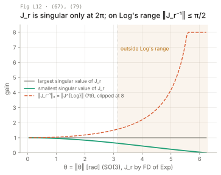

**Intuition.** Log, ⊕ and ⊖ are compositions of Exp, inverse and composition, so their Jacobians are products of L11's
blocks. Two facts are worth memorizing. The ⊕ step is the identity block on τ only at τ = 0; away from it, J_r(τ)
appears. ⊖ produces J_r⁻¹ and J_l⁻¹, which is where residual Jacobians in an optimizer come from.

**Formal.** With τ = Log(𝒳) for (79), τ the increment for (80)–(81), and τ = 𝒴 ⊖ 𝒳 for (82)–(83):

| Block | Result | Eq. |
| --- | --- | --- |
| J^{Log 𝒳}_𝒳 | J_r⁻¹(τ) | (79) |
| J^{𝒳⊕τ}_𝒳 | Ad_{Exp(τ)}⁻¹ | (80) |
| J^{𝒳⊕τ}_τ | J_r(τ) | (81) |
| J^{𝒴⊖𝒳}_𝒳 | −J_l⁻¹(τ) | (82) |
| J^{𝒴⊖𝒳}_𝒴 | J_r⁻¹(τ) | (83) |

**The derivation in one idea (82).** Chain Log ∘ (∘) ∘ inverse with (79), (65) and (62) to get −J_r⁻¹ Ad_{𝒴⁻¹𝒳}.
Rewrite 𝒴⁻¹𝒳 as Exp(τ)⁻¹, then use (33) and (75) to fold J_r⁻¹ Ad_{Exp(τ)}⁻¹ into J_l⁻¹ (p. 11).

**Your robots.** A between-factor residual in FORGE, Log(Z⁻¹ 𝒳ᵢ⁻¹ 𝒳ⱼ), has Jacobians built from (79), (65) and (62).
GTSAM's `BetweenFactor` is the same construction. Near convergence τ ≈ 0, so J_r⁻¹ ≈ I. Many hand-written factors use
that approximation, and they pay for it in convergence speed when the initial error is large.

---

## L13. Composite manifolds (IV)

**Picture.** One τ, with ρ = p = (2, 0) m and θ = π/2, applied from the same pose M under three manifold structures
(Ex. 7). All three end with the same heading. SE(2) follows an arc, T(2)×SO(2) a straight line in the body frame, and
⟨ℝ², SO(2)⟩ a straight line in the world frame, so the three end positions differ.

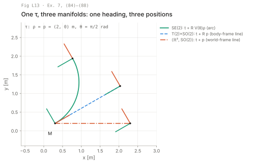

**Intuition.** A robot state is a stack of unrelated pieces: pose, velocity, biases, landmarks. Treat each piece with
its own group and stack the results, with no coupling between blocks. The stack is still a Lie group
(per-block composition is a direct product, and the paper notes it fulfils the group axioms, p. 11), but not the same
group as the coupled one: ⟨ℝⁿ, SO(n)⟩ is not SE(n), and its ⊕ moves along a different path (Ex. 7). Exp, Log, ⊕, ⊖ and
the Jacobians then act block by block.

**Formal.** For ℳ = ⟨ℳ₁, …, ℳ_M⟩, identity, inverse and composition act per block (84), and so do Exp⟨τ⟩ and Log⟨𝒳⟩
(85). The diamond operators are

```latex
\mathcal X\,\diamondplus\,\boldsymbol\tau\triangleq\mathcal X\diamond\mathrm{Exp}\langle\boldsymbol\tau\rangle\quad(86)
\qquad
\mathcal Y\,\diamondminus\,\mathcal X\triangleq\mathrm{Log}\langle\mathcal X^{\diamond}\diamond\mathcal Y\rangle\quad(87)
```

(written ⊕ and ⊖ with a diamond in the paper). The Jacobian is the block matrix of per-block Jacobians (89), and the
covariance is (91), Σ = E[(𝒳 ⊖◇ 𝒳̄)(𝒳 ⊖◇ 𝒳̄)ᵀ], n×n with n = Σ mᵢ. Ex. 7 compares the three ways to model a rigid
motion:

| Structure | ⊕ (translation part) | ⊖ (translation part) |
| --- | --- | --- |
| SE(n) | t + R V(θ) ρ | V₁⁻¹ R₁ᵀ(p₂ − p₁) |
| T(n)×SO(n) | t + R p | R₁ᵀ(p₂ − p₁) |
| ⟨ℝⁿ, SO(n)⟩ | t + p | p₂ − p₁ |

The rotation part is the same in all three: R Exp(θ) and Log(R₁ᵀR₂). In the SE(n) ⊖ row, V₁⁻¹ means
V⁻¹(Log(R₁ᵀR₂)). That is this package's reading: the paper's subscript suggests V(θ₁), but the SE(n) Log, (157) and
(173), applies V⁻¹ to the angle of the relative rotation R₁ᵀR₂, and only that is consistent with Exp.

The paper's advice (p. 11): use SE(n) or T(n)×SO(n) for the dynamics, usually not the composite; use the composite
⊕◇ and ⊖◇ for errors and uncertainty.

**Your robots.** The quadruped's ⟨p, v, R, b_g, b_a, feet⟩ is a composite of this kind, and so is FAST-LIO2's
SO(3) × ℝⁿ × S² (lesson t2.8). Choosing SE(3) or ⟨ℝ³, SO(3)⟩ for the pose changes F, P and the meaning of "position
error". Pick one per robot and write it at the top of `models.py`.

---

## L14. The common setup for §V (V intro)

**Picture.** The scene of Fig. 12: three SE(2) poses, three beacons in ℝ², motion factors (black) and beacon factors
(coral). On the right, what the sensor at 𝒳₂ reports: each beacon in the robot frame, y = 𝒳₂⁻¹ · b.

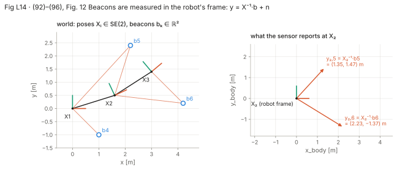

**Intuition.** One planar robot, point beacons, and a body-frame twist as the control. The control's noise has a
lateral component even though the commanded lateral velocity is zero. That component models wheel slip, and it is
what makes the noise on the twist three-dimensional rather than two.

**Formal.** 𝒳 ∈ SE(2) (152), b_k ∈ ℝ² (App. E). The control and its noise:

```latex
\mathbf u=\begin{bmatrix}u_v\\u_s\\u_\omega\end{bmatrix}=\begin{bmatrix}v\,\delta t\\0\\\omega\,\delta t\end{bmatrix}+\mathbf w\in\mathfrak{se}(2)\quad(92)
\qquad
\mathbf W=\mathrm{diag}(\sigma_v^2\delta t,\ \sigma_s^2\delta t,\ \sigma_\omega^2\delta t)\quad(93)
```

Motion (94) and beacon measurement (95)–(96):

```latex
\mathcal X_j=\mathcal X_i\oplus\mathbf u_j\triangleq\mathcal X_i\,\mathrm{Exp}(\mathbf u_j)\quad(94)
\qquad
\mathbf y_k=\mathcal X^{-1}\cdot\mathbf b_k+\mathbf n=\mathbf R^\top(\mathbf b_k-\mathbf t)+\mathbf n,\ \ \mathbf N=\mathrm{diag}(\sigma_x^2,\sigma_y^2)\quad(95\text{–}96)
```

**Misprint.** (93) prints the third diagonal entry with σ_w (a "w"). It is the angular-rate channel, σ_ω.

**Your robots.** This is the tracked robot almost word for word. u_s is skid: a tracked vehicle slips sideways in every
turn, and σ_s is how you tell the filter so. The beacons are your RoboCup arena's fiducials or the reflector posts a
LiDAR picks out, measured in Cartesian body coordinates as in (95).

---

## L15. Localization with an error-state Kalman filter on the manifold (V-A)

**Picture.** Left: 25 prediction steps of (99)–(100) from a tight prior, against a 2000-sample Monte Carlo cloud of
the true motion. The 2σ ellipses of P (blue) follow the cloud as it curves, and 95.6 % of the samples fall inside the
χ²₃ 95 % set of the final P. Right: one beacon correction (101)–(102). tr P (mixed units, m² and rad²) drops from 0.109
to 0.020, and the position error of the estimate drops from 0.159 m to 0.123 m in this run.

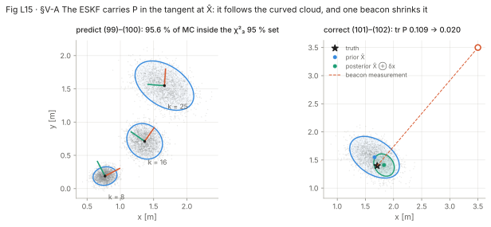

**Intuition.** The filter keeps a nominal pose 𝒳̂ on the group and a small error δx in the tangent at 𝒳̂. Everything
Kalman, the gain, the innovation and the covariance, happens to δx, which is an ordinary 3-vector. Compared with a
textbook EKF only two lines change: the mean prediction and the state update use ⊕ instead of +. The Jacobians come
from the block table instead of from differentiating sines and cosines.

**Formal.** Error and covariance (97)–(98):

```latex
\delta\mathbf x\triangleq\mathcal X\ominus\hat{\mathcal X}\in\mathbb R^3\quad(97)
\qquad
\mathbf P\triangleq\mathbb E[(\mathcal X\ominus\hat{\mathcal X})(\mathcal X\ominus\hat{\mathcal X})^\top]\in\mathbb R^{3\times3}\quad(98)
```

| Eq. | Equation | Step |
| --- | --- | --- |
| (99) | 𝒳̂_j = 𝒳̂_i ⊕ u_j | predict mean |
| (100) | P_j = F P_i Fᵀ + G W_j Gᵀ,  F = Ad_{Exp(u_j)}⁻¹ (80),  G = J_r(u_j) (81) | predict covariance |
| unnumbered, above (101) | z = y_k − 𝒳̂⁻¹·b_k;  Z = H P Hᵀ + N;  K = P Hᵀ Z⁻¹;  δx = K z | innovation, gain, observed error |
| (101) | 𝒳̂ ← 𝒳̂ ⊕ δx | state update |
| (102) | P ← P − K Z Kᵀ | covariance update |

H = J^{𝒳⁻¹·b}_{𝒳⁻¹} J^{𝒳⁻¹}_𝒳 = [Rᵀ  Rᵀ[1]ₓb] [[−R, [1]ₓt], [0, −1]] = −[I  Rᵀ[1]ₓ(b − t)], 2×3 (p. 12). L10
checks this chain numerically. In the figure's run, the finite-difference F agrees with Ad_{Exp(u)}⁻¹ to
1.5 × 10⁻¹⁰.

**What the paper leaves out.** After 𝒳̂ ← 𝒳̂ ⊕ δx, P is still a covariance in the tangent at the old 𝒳̂. A full ESKF
moves it to the new tangent with P ← J P Jᵀ. Differentiating the new error Exp(δx)⁻¹ ∘ Exp(δx + ε) at ε = 0 with (81)
and (83) gives J = J_r(δx) to first order; Solà's quaternion-kinematics report, ref. [8] (not in `books.yaml` yet),
derives the quaternion version. For small δx, J ≈ I, which is what (102) implicitly assumes.

**Your robots.** The tracked robot's localizer is this filter with real W and N. The drone's and quadruped's
error-state filters are the same five lines in SE(3) or a composite, with F and G from App. D or per-block from (89).
If you replace the closed-form F with a finite difference, as in the figure, the filter output changes only at the
10⁻¹⁰ level of the F residual above. That is a cheap way to debug a new model.

---

## L16. Smoothing and mapping with graph-based optimization (V-B)

**Picture.** The block pattern of the stacked Jacobian J (107) for the Fig. 12 problem, and of JᵀJ. J is 19×15 with
33 % of its entries in nonzero blocks, and JᵀJ is 15×15 with 60 %. Each row block touches one or two column blocks.

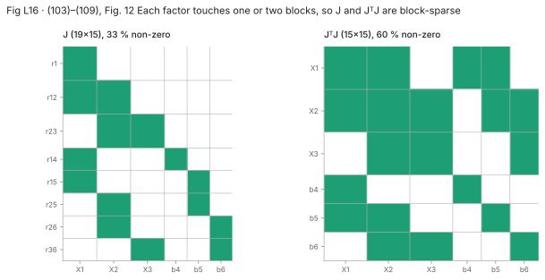

**Intuition.** Put every pose and beacon into one composite state and write one whitened residual per factor. Then
run Gauss-Newton exactly as in ℝⁿ, except that the step is applied with ⊕◇. The Jacobian of each residual has only
one or two nonzero blocks, and the solver's speed comes from that sparsity. The figure's problem is small enough that
the fill percentages are high; a real trajectory with thousands of poses gives a J that is almost all zeros.

**Formal.** State (103) 𝒳 = ⟨𝒳₁, 𝒳₂, 𝒳₃, b₄, b₅, b₆⟩, 𝒳ᵢ ∈ SE(2), b_k ∈ ℝ². Measurements u_ij = 𝒳_j ⊖ 𝒳ᵢ + w_ij (104),
y_ik = 𝒳ᵢ⁻¹ · b_k + n_ik (105). Residuals whitened with Ω^{T/2}, Ω = W⁻¹ or N⁻¹ (p. 13):

```latex
\mathbf r_1=\boldsymbol\Omega_1^{\top/2}(\mathcal X_1\ominus\hat{\mathcal X}_1),\quad
\mathbf r_{ij}=\boldsymbol\Omega_{ij}^{\top/2}\big(\mathbf u_{ij}-(\hat{\mathcal X}_j\ominus\hat{\mathcal X}_i)\big),\quad
\mathbf r_{ik}=\boldsymbol\Omega_{ik}^{\top/2}(\mathbf y_{ik}-\hat{\mathcal X}_i^{-1}\cdot\hat{\mathbf b}_k)
```

```latex
\delta\mathbf x^*=\arg\min_{\delta\mathbf x}\|\mathbf r+\mathbf J\delta\mathbf x\|^2\quad(108)
\qquad
\delta\mathbf x^*=-(\mathbf J^\top\mathbf J)^{-1}\mathbf J^\top\mathbf r\quad(109)
\qquad
\mathcal X\leftarrow\mathcal X\,\diamondplus\,\delta\mathbf x^*\quad(110)
```

P = {1, 12, 23, 14, 15, 25, 26, 36} lists the factors (106). The blocks of J (107) are J^{r_p}_{𝒳ᵢ} and J^{r_p}_{b_k},
built from L11–L12 and the action blocks of App. C, because J^{f(𝒳⊕◇δx)}_{δx} at δx = 0 equals J^{f(𝒳)}_𝒳 (p. 13).
For large problems, (109) is solved by QR or Cholesky, never by forming the inverse (refs. [12]–[15]).

**Your robots.** This is FORGE's back-end in miniature, with GTSAM or g2o in place of (109). Robust kernels,
marginalization and iSAM2's incremental updates are not in the paper; they come in lesson t2.8 (Grisetti). The
RoboCup map is the same problem with more beacons and a longer trajectory.

---

## V-C Smoothing and mapping with self-calibration (skim, p. 13)

An unknown odometry bias c = (c_v, c_ω) ∈ ℝ² joins the state as one more ℝⁿ block. The motion residual passes the
measured control through a correction c(ũ, c) (111) before comparing it with 𝒳̂_j ⊖ 𝒳̂ᵢ. The only change to J is one
extra block column on the left: J^c_{r_ij} = Ω^{T/2} J^{c(u_ij, c)}_c, with a 3×2 inner Jacobian. On the tracked robot,
c is the track-speed scale and yaw-rate bias you otherwise calibrate by hand on a test loop.

## V-D 3D implementations (skim, p. 13)

Replace SE(2) with SE(3), u ∈ ℝ⁶ ≅ 𝔰𝔢(3) and b, y ∈ ℝ³, and every line from (97) on carries over unchanged. Only the
block sizes and the closed forms (App. D) change.

## VI Conclusion (skip)

It restates the paper's choices; there is nothing new in it.

---

## App. A The 2D rotation groups S¹ and SO(2) (skim, p. 14)

S¹ and SO(2) share the tangent θ ∈ ℝ, and Exp/Log are the Euler formula and atan2 (114)–(117). Rotations in the plane
commute, so Exp(θ₁ + θ₂) = Exp(θ₁) Exp(θ₂) (120) and Q ⊖ R = θ_Q − θ_R (122), wrapped. Every Jacobian is the scalar 1
or −1 (123)–(128): Ad = 1, J_r = J_l = 1. The action blocks are R[1]ₓv and R (129)–(130). This is the case where a
plain heading angle with `wrap()` is exactly right.

---

## L17. The 3D rotation groups S³ and SO(3) (App. B)

**Picture.** The relative float64 error of two coefficients of J_r (143), evaluated as printed. Both lose every digit
for θ below about 10⁻⁸ rad: (1 − cos θ)/θ² below 1.0 × 10⁻⁸ and (θ − sin θ)/θ³ below 2.1 × 10⁻⁸. Accuracy degrades long
before that: the relative error is 5.6 × 10⁻⁹ for the first at θ = 10⁻⁴, and 4.2 × 10⁻¹⁰ for the second at θ = 10⁻³.

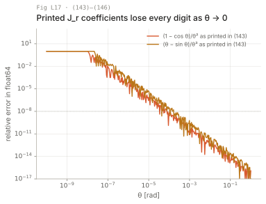

**Intuition.** SO(3) and S³ share the tangent ℝ³, so every Jacobian is the same whichever one stores the attitude
(p. 15). The formulas are exact, but almost every one divides by θ, θ² or θ³. A filter running at rest sees θ ≈ 0 all
the time. Every implementation therefore needs a small-angle branch that switches to a Taylor series, and the paper
does not say where to switch. The figure shows where float64 forces you to.

**Formal.** Quaternion Exp/Log (132)–(133). Before Log, make w > 0 by flipping q → −q, so that Log returns the short
rotation (S³ double-covers SO(3)):

```latex
\mathbf q=\mathrm{Exp}(\theta\mathbf u)=\cos(\theta/2)+\mathbf u\sin(\theta/2)\quad(132)
\qquad
\theta\mathbf u=\mathrm{Log}(\mathbf q)=2\,\mathbf v\,\frac{\arctan(\|\mathbf v\|,w)}{\|\mathbf v\|}\quad(133)
```

Rotation matrix Exp/Log (134)–(135), with θ = cos⁻¹((tr R − 1)/2):

```latex
\mathbf R=\mathbf I+\sin\theta\,[\mathbf u]_\times+(1-\cos\theta)[\mathbf u]_\times^2\quad(134)
\qquad
\theta\mathbf u=\frac{\theta(\mathbf R-\mathbf R^\top)^\vee}{2\sin\theta}\quad(135)
```

Ad_R = R (139); J^{R⁻¹}_R = −R (140); J^{QR}_Q = Rᵀ (141). Right Jacobian (143) and inverse (144):

```latex
\mathbf J_r(\boldsymbol\theta)=\mathbf I-\frac{1-\cos\theta}{\theta^2}[\boldsymbol\theta]_\times+\frac{\theta-\sin\theta}{\theta^3}[\boldsymbol\theta]_\times^2\quad(143)
\qquad
\mathbf J_r^{-1}(\boldsymbol\theta)=\mathbf I+\tfrac12[\boldsymbol\theta]_\times+\Big(\frac1{\theta^2}-\frac{1+\cos\theta}{2\theta\sin\theta}\Big)[\boldsymbol\theta]_\times^2\quad(144)
```

J_l and J_l⁻¹ (145)–(146) flip the sign of the [θ]ₓ term, so J_l = J_rᵀ (147). ⊕/⊖ blocks (148)–(149); action
J^{R·v}_R = −R[v]ₓ (150), J^{R·v}_v = R (151).

**What breaks.** (135) is 0/0 at θ → 0 and again at θ → π, where R − Rᵀ → 0 and sin θ → 0. The second case needs a
different formula, taken from the symmetric part of R; the paper does not give it, and the cards will. (144) has sin θ in a
denominator too: at θ = π its coefficient is 0/0 with a finite limit (L12 shows J_r⁻¹ stays bounded there), and it
blows up only at 2π. Evaluate it near π with care; the closed form is worse conditioned than the matrix it computes.

**Your robots.** The drone and the quadruped both run this table at the IMU rate. A hover or a standing pose means
θ ≈ 0 on every gyro step, and that is the branch to test first. manif and GTSAM switch to the series at a small
threshold; the cards record the thresholds those libraries use.

---

## L18. The 2D rigid motion group SE(2) (App. C)

**Picture.** Exp((ρ, θ)) with ρ = (2, 0) m and four values of θ (left). The robot drives ‖ρ‖ along an arc, so the
straight-line distance it ends up from the start shrinks as θ grows (right). At θ = π the ratio is 0.637 = 2/π in this
run.

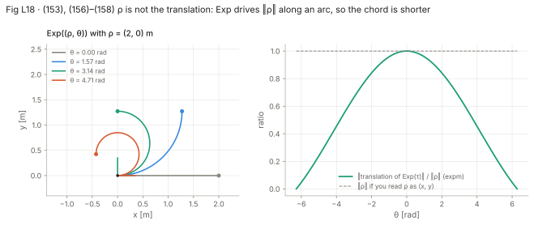

**Intuition.** The SE(2) tangent is a body-frame twist integrated for unit time: drive forward ρ while turning θ, at
the same time. ρ is not the translation of the resulting pose. V(θ) converts one into the other, and V⁻¹ in Log
converts back. A pose covariance in (ρ, θ) is therefore not the same thing as one in (x, y, θ).

**Formal.** M = [[R, t], [0, 1]] (152), τ = (ρ, θ) (153). Inverse and composition (154)–(155). Exp and Log
(156)–(158):

```latex
\mathrm{Exp}(\boldsymbol\tau)=\begin{bmatrix}\mathrm{Exp}(\theta)&\mathbf V(\theta)\boldsymbol\rho\\\mathbf 0&1\end{bmatrix}\ (156)
\quad
\mathrm{Log}(\mathbf M)=\begin{bmatrix}\mathbf V^{-1}(\theta)\mathbf t\\\mathrm{Log}(\mathbf R)\end{bmatrix}\ (157)
\quad
\mathbf V(\theta)=\frac{\sin\theta}{\theta}\mathbf I+\frac{1-\cos\theta}{\theta}[1]_\times\ (158)
```

Adjoint (159), 3×3:

```latex
\mathbf{Ad}_{\mathbf M}=\begin{bmatrix}\mathbf R&-[1]_\times\mathbf t\\\mathbf 0&1\end{bmatrix} \qquad (159)
```

The inverse and composition blocks follow from it (160)–(162). The closed-form J_r and J_l (163)–(164) take their
third column from ρ and θ. The action blocks are J^{M·p}_M = [R  R[1]ₓp] (166) and J^{M·p}_p = R (167). The figure's
ratio is ‖V(θ)ρ‖/‖ρ‖ = |sin(θ/2)|/(θ/2), which follows from (158); it is 1 at θ = 0 and 0 at θ = ±2π.

**Your robots.** This is the tracked robot's group, and all of §V runs on it. Exercise T3 implements this appendix and
checks it against `expm` and finite differences, the same oracles the figures use. The third column of (163) is the
one people get wrong, because its terms have θ² in the denominator and change sign with θ.

---

## App. D The 3D rigid motion group SE(3) (skim, reference, pp. 16–17)

SE(3) has the same structure as App. C with SO(3) blocks. V(θ) in (174) is exactly J_l(θ) of SO(3) (145). Ad_M =
[[R, [t]ₓR], [0, R]] (175), derived in Ex. 6. The left Jacobian (179) is block upper triangular, with the 3×3 Q(ρ, θ) of
(180) as its off-diagonal block. Q is long and full of high powers of θ in the denominators; implement it from the
equation, then test it by finite differences, and get the right Jacobian from (76), J_r(ρ, θ) = J_l(−ρ, −θ). The action
is J^{M·p}_M = [R  −R[p]ₓ] (182). Use this appendix as the formula sheet for the drone and the quadruped.

## App. E The translation groups (ℝⁿ, +) and T(n) (skim, p. 17)

ℝⁿ under addition is a Lie group in which Exp is the identity, ⊕ is + and ⊖ is − (185)–(187). Every block is I or −I
(188)–(193). It is how the beacons, velocities and biases enter a composite state without special cases.

---

## L19. How to tell what is wrong

| Symptom | Likely cause | Try |
| --- | --- | --- |
| `just fd` residual slope 1 instead of 2 (L7) | wrong block, or ⊖ taken on the wrong side | test each block of the chain on its own (L10); check right vs left |
| Jacobian right at 𝒳 = I, wrong elsewhere | missing Ad, or a local Jacobian used as a global one | (46), (57); compare with the generic Ad from (31) |
| NaN or Inf when the robot stands still | division by θ in Exp, Log, J_r, V(θ) | Taylor branch below a threshold (L17); test at θ = 0 and θ = 10⁻¹⁰ |
| Attitude error jumps by 2π, or the robot turns the long way | Log's branch cut at π, or quaternion with w < 0 | flip q to w > 0 before Log (133); wrap planar angles |
| Log(R) wrong near 180° | (135) is 0/0 at θ = π | use the symmetric-part formula near π |
| Filter consistent when driving straight, overconfident when turning | Euler integration, or F from (x, y, θ) | integrate with Exp (56); F = Ad_{Exp(u)}⁻¹ (100) |
| Position covariance looks wrong after a long turn | Σ is in (ρ, θ) but read as (x, y, θ) | map it through J or V(θ) (L8, L18) |
| Covariance looks right in body frame, wrong in world | frame mismatch | ᴱΣ = Ad Σ Adᵀ (54) |
| Two codebases disagree on the same pose Jacobian | tangent order (ρ, θ) vs (θ, ρ), or right vs left perturbation | permute blocks; (75), (147) |
| Gauss-Newton converges slowly from a poor start | J_r⁻¹ ≈ I assumed in residual Jacobians | use (82)–(83) in full |
| Overconfidence after large corrections | P not moved to the new tangent after ⊕ | reset P with J_r(δx) (L15), ref. [8] |
