# Lecture: Nonparametric filters

Four layers per section: picture, intuition, formal, your robots. Equation numbers are the book's; code is in `translate.md`. Every number below is in `figures/numbers.json`, written by `figures/make_figures.py`.

---

## L1. Why drop the Gaussian (ch. 4 intro, pp. 85–86)

**Picture.** One two-humped belief, stored three ways: as a Gaussian (ch. 3), as a histogram (4.1), as particles (4.3).

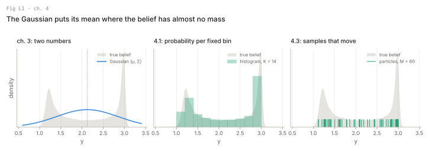

**Intuition.** A Gaussian of a two-humped belief puts its centre between the humps: in Fig L1 the mean sits where the true density is 0.097 of its peak. A nonparametric filter stores a finite set of numbers instead, a probability per fixed region or a set of samples. The price is computation, which for grids grows exponentially with the state dimension.

**Formal.** No equation; two definitions (p. 86). *Adaptive*: the number of parameters follows the complexity of the posterior. *Resource-adaptive*: it follows the compute available, e.g. M set from the time left in the control cycle. Convergence as the parameter count grows holds "under specific smoothness assumptions" (p. 85), not proved here.

**Your robots.** The RoboCup field is point-symmetric: a robot that sees one goal and a penalty box has two equally good poses, mirrored through the centre spot. A Gaussian filter averages them onto the centre circle. Global localization of the tracked robot in a building of similar corridors is the same problem with more humps.

---

## L2. The discrete Bayes filter (4.1.1, Table 4.1)

**Picture.** A robot on a 10 m ring corridor with doors at 1.5, 4.0 and 7.5 m sees a door, drives 2.5 m, sees a door again.

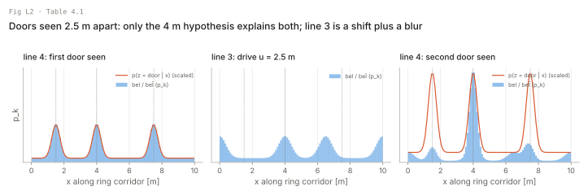

**Intuition.** Table 2.1 with the integral replaced by a sum. Predict pushes each bin's probability through the motion model (a shift plus a blur); update multiplies by the likelihood and renormalizes. After the second door only "was at 1.5 m, now at 4.0 m" explains both: 0.53 of the mass lies within 1 m of 4.0 m, the rest spread thin by the detector's 0.1 false-positive floor.

**Formal.** Table 4.1:

| Line | Equation | Step |
| --- | --- | --- |
| 2 | for all k do | |
| 3 | p̄ₖ,ₜ = Σᵢ p(Xₜ = xₖ ∣ uₜ, Xₜ₋₁ = xᵢ) pᵢ,ₜ₋₁ | predict |
| 4 | pₖ,ₜ = η p(zₜ ∣ Xₜ = xₖ) p̄ₖ,ₜ | update |
| 6 | return {pₖ,ₜ} | |

Shapes: the belief is a vector p ∈ ℝᴷ with Σₖ pₖ = 1. Line 3 over all k is a matrix–vector product p̄ = T p with T ∈ ℝᴷˣᴷ, Tₖᵢ = p(xₖ ∣ u, xᵢ), each column summing to 1. Line 4 is an element-wise product with the likelihood vector ℓ ∈ ℝᴷ, then a division by the sum (η). In signal processing this is the forward pass of a hidden Markov model (p. 87).

**Your robots.** Grid localization in ch. 8 is this table over (x, y, θ) cells. A finite state space you already have: the quadruped's contact state per foot (stance / swing) estimated from joint torque and gait phase is a two- or four-state discrete Bayes filter, run at control rate, with T taken from the gait schedule.

---

## L3. Histograms over a continuous state (4.1.2, (4.1)–(4.5))

**Picture.** After Fig 4.1: a Gaussian x cut into ten bins, each bin pushed through a nonlinear g, the mass collected in bins of y.

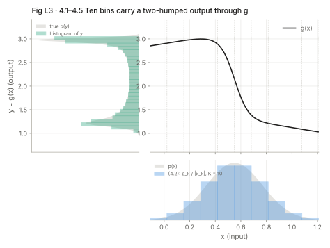

**Intuition.** Table 4.1 on bins. Inside a bin the density is flat, and the continuous models are evaluated at one representative point per bin. Unlike the EKF it does not care that g is nonlinear. The error is the bin width: total variation distance from the true p(y) is 0.066 with five bins, 0.021 with ten, 0.006 with forty.

**Formal.** A partition of the state space into K convex regions (4.1):

```latex
\mathrm{dom}(X_t) = \mathbf x_{1,t} \cup \mathbf x_{2,t} \cup \dots \cup \mathbf x_{K,t}, \qquad \mathbf x_{i,t} \cap \mathbf x_{k,t} = \emptyset \ (i \neq k)
```

Piecewise constant density (4.2), with |xₖ,ₜ| the volume of the region:

```latex
p(x_t) = \frac{p_{k,t}}{|\mathbf x_{k,t}|} \quad \text{for } x_t \in \mathbf x_{k,t}
```

Representative state, the mean of the region (4.3), and the two substitutions (4.4), (4.5):

```latex
\hat x_{k,t} = |\mathbf x_{k,t}|^{-1} \int_{\mathbf x_{k,t}} x_t \, dx_t
```
```latex
p(z_t \mid \mathbf x_{k,t}) \approx p(z_t \mid \hat x_{k,t}), \qquad p(\mathbf x_{k,t} \mid u_t, \mathbf x_{i,t-1}) \approx \eta\, |\mathbf x_{k,t}|\, p(\hat x_{k,t} \mid u_t, \hat x_{i,t-1})
```

The η in (4.5) exists because probed densities do not sum to 1 over k; normalize each column of T in code. The book calls this "a Taylor-approximation analogous to the one used by EKFs" (p. 89): zeroth order, per bin.

**Your robots.** A planar pose grid of 20 m × 20 m at 0.1 m and 5° has 200 · 200 · 72 = 2,880,000 cells; a dense T would have 2,880,000² entries. Ways out (card C1): a shift-invariant motion model makes line 3 a convolution; selective updating (4.1.4) skips negligible cells. For the drone's 6-DoF pose plus velocity a grid is out of the question.

### 4.1.3 Derivation of the histogram approximation (skim)

(4.6) writes p(zₜ ∣ xₖ,ₜ) exactly as a ratio of integrals over the bin. Under the flat-density assumption (4.2) it reduces to an average of p(zₜ ∣ xₜ) over the bin, so the only real approximation in (4.4) is replacing that average by the value at x̂ₖ,ₜ. Derive (4.7) from (4.6) once by hand. Compare line 3 with (4.10): the p̄ₖ of line 3 are not normalized, and the η of line 4 does the normalizing (p. 92).

### 4.1.4 Decomposition techniques (skim)

Static decompositions fix the grid in advance; dynamic ones refine it where the belief has mass (density trees, Fig. 4.2). Selective updating touches only bins above a threshold. Topological decompositions follow rooms and corridors instead of a metric grid.

---

## L4. The binary Bayes filter with static state (4.2, Table 4.2)

**Picture.** One cell, prior 0.3, thirty readings from an inverse sensor model. Left: the log odds as a running sum. Right: the same belief as a probability. Dashed: the same code with the prior term forgotten.

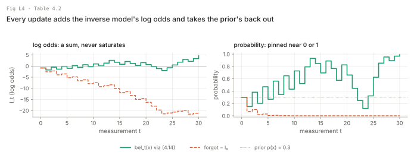

**Intuition.** For one static bit, Table 4.1 collapses to one number, best kept as log odds: each reading adds its evidence and takes the prior back out, because the inverse model already contains it. Probabilities pin at 0 or 1; log odds are an unbounded sum. In Fig L4 fifteen hits in thirty give bel = 0.990, matching Table 4.1 on two states to four decimals; dropping the prior term turns the same readings into bel = 0.000.

**Formal.** Static state, belief over x and ¬x (4.11), odds (4.12), log odds (4.13), recovery (4.14):

```latex
l(x) := \log \frac{p(x)}{1-p(x)} \qquad\qquad bel_t(x) = 1 - \frac{1}{1+\exp\{l_t\}}
```

Table 4.2:

| Line | Equation |
| --- | --- |
| 2 | lₜ = lₜ₋₁ + log [p(x ∣ zₜ) / (1 − p(x ∣ zₜ))] − log [p(x) / (1 − p(x))] |
| 3 | return lₜ |

with l₀ = log [p(x) / (1 − p(x))] (4.21). All scalars. p(x ∣ zₜ) is an **inverse measurement model**: the probability of the state given the reading, not of the reading given the state.

**The derivation in one idea (4.15)–(4.20).** Apply Bayes rule to the measurement model, p(zₜ ∣ x) = p(x ∣ zₜ) p(zₜ) / p(x) (4.16), write the same posterior for ¬x (4.18), and divide. Everything that is hard to compute, p(zₜ) and p(zₜ ∣ z₁:ₜ₋₁), cancels in the ratio (4.19). Take the log and the update is a sum (4.20).

**Wording warning.** p. 96 says each update "involves the addition of the prior (in log odds form)". (4.20) and Table 4.2 line 2 subtract it. Code the subtraction.

**Notation warning.** The book's (4.14) as written overflows exp(lₜ) for lₜ > 709 and, for very negative lₜ, cancels to exactly 0 instead of a tiny belief. Use the logistic function, `scipy.special.expit(l)`, which is the same expression and is stable for any l. Practical grid mappers (OctoMap, for example) also clamp l to a band so a cell can still change its mind; that is common practice, not in Table 4.2 or in ch. 9's Table 9.1.

**Your robots.** Every cell of the tracked robot's and the quadruped's occupancy grid is one Table 4.2 with an inverse LiDAR model (ch. 9). So is any static yes/no question over noisy detections: is this stair edge real, is this door open.

---

## L5. The particle filter (4.3.1, Table 4.3)

**Picture.** One pass of Table 4.3 on a 1-D linear-Gaussian system, where the Kalman filter gives the exact answer to compare against.

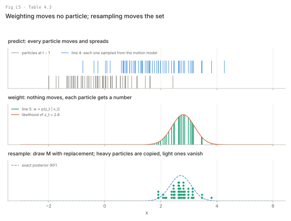

**Intuition.** Keep M guesses. Move each by a random draw from the motion model, score each by the measurement likelihood, draw M again with replacement in proportion to score. Nothing is linearized: any motion model you can sample and any likelihood you can evaluate will do. In Fig L5 the 60 particles survive as 20 distinct ones; mean 2.678 against the KF's 2.709, standard deviation 0.378 against 0.377.

**Formal.** A particle set (4.22) is Xₜ = {xₜ^[1], …, xₜ^[M]}, M particles each in ℝⁿ: an M × n array in code. Table 4.3:

| Line | Equation | Step |
| --- | --- | --- |
| 2 | X̄ₜ = Xₜ = ∅ | |
| 4 | sample xₜ^[m] ∼ p(xₜ ∣ uₜ, xₜ₋₁^[m]) | predict, one draw per particle |
| 5 | wₜ^[m] = p(zₜ ∣ xₜ^[m]) | importance factor |
| 6 | X̄ₜ = X̄ₜ + ⟨xₜ^[m], wₜ^[m]⟩ | weighted set = bel̄ plus weights |
| 9 | draw i with probability ∝ wₜ^[i] | resample |
| 10 | add xₜ^[i] to Xₜ | |
| 12 | return Xₜ | |

The ideal (4.23) is xₜ^[m] ∼ p(xₜ ∣ z₁:ₜ, u₁:ₜ); it holds only as M → ∞ (p. 98). The variant without resampling keeps a weight per particle and multiplies it (4.24): wₜ^[m] = p(zₜ ∣ xₜ^[m]) wₜ₋₁^[m]. It is correct but wastes particles in regions of low posterior (p. 100).

**Wording warning.** p. 99 calls lines 8–11 "resampling or importance sampling". Importance sampling is the weighting of 4.3.2; resampling is lines 8–11. Keep the names apart in code.

**Your robots.** Monte Carlo localization on the RoboCup field (ch. 8): line 4 is the odometry model of ch. 5, line 5 the field-line likelihood of ch. 6. On the drone keep a PF to low-dimensional sub-problems, e.g. which of several landing pads you are over.

---

## L6. Importance sampling (4.3.2, (4.25)–(4.29))

**Picture.** After Fig 4.4: a target f, a proposal g that mostly sits elsewhere, samples of g weighted by f/g. Right: the error of the weighted estimate against M for three proposals.

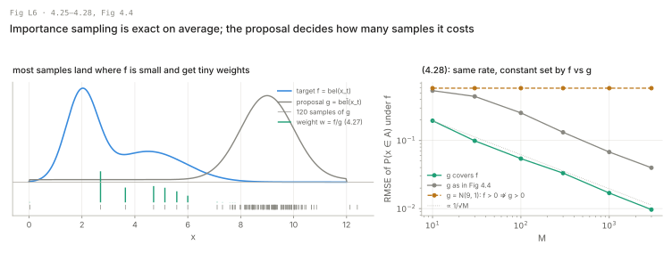

**Intuition.** Draw from g, weight each sample by f/g, and averages under f come out right. The cost depends on how well g covers f. For P(x ∈ (0, 3)) = 0.587 under f, a covering proposal has RMSE 0.017 at M = 1000; the book's proposal, piled up at x = 9, has 0.068, so it needs about sixteen times the samples. Both fall as 1/√M. N(9, 1), effectively zero where f is not, returns 0 at every M.

**Formal.** (4.25):

```latex
E_f[I(x \in A)] = \int \frac{f(x)}{g(x)}\, g(x)\, I(x \in A)\, dx = E_g[w(x)\, I(x \in A)], \qquad w(x) = \frac{f(x)}{g(x)}
```

valid only if f(x) > 0 ⟹ g(x) > 0. Weights per sample (4.27), and the self-normalized estimate (4.28):

```latex
w^{[m]} = \frac{f(x^{[m]})}{g(x^{[m]})}, \qquad \Big[\sum_{m=1}^{M} w^{[m]}\Big]^{-1} \sum_{m=1}^{M} I(x^{[m]} \in A)\, w^{[m]} \;\longrightarrow\; \int_A f(x)\,dx
```

The rate is O(1/√M) with a constant set by the similarity of f and g (p. 102). In the particle filter f = bel(xₜ) and g is the product (4.29), p(xₜ ∣ uₜ, xₜ₋₁) bel(xₜ₋₁): the motion model applied to the previous belief.

**From outside the book.** Dividing by Σw makes (4.28) biased by O(1/M); L10 shows it in the filter. The effective sample size N_eff = 1 / Σ w̃² of normalized weights is a monotone function of the weight variance of p. 109; the package uses it as the resampling trigger (card C4).

**Your robots.** The proposal is the motion model. On the tracked robot skid-steer slip makes odometry wide while a LiDAR scan match is sharp: Fig 4.4's situation. Fixes: a proposal that uses zₜ (FastSLAM 2.0, ch. 13) or a deliberately widened likelihood.

---

## L7. Why weighting by the likelihood is right (4.3.3, (4.30)–(4.35))

**Picture.** A particle filter that remembers where each particle came from. Gray: particles at each step. Teal: the histories of the particles still alive at t = 30.

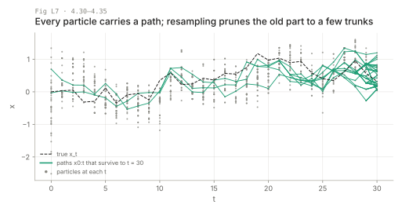

**Intuition.** Treat each particle as a whole path x₀:ₜ. Over paths the recursion has no integral, the motion term appears in target and proposal and cancels, and the weight left is the measurement likelihood. Fig L7 shows the cost: of 40 particles at t = 0 only 2 have descendants at t = 30, and the 40 paths share 4 states at t = 20. The set describes the present well and the past badly.

**Formal.** Paths (4.30) and their posterior (4.31):

```latex
x_{0:t}^{[m]} = x_0^{[m]}, x_1^{[m]}, \dots, x_t^{[m]}, \qquad bel(x_{0:t}) = p(x_{0:t} \mid u_{1:t}, z_{1:t})
```

Bayes then Markov twice (4.32):

```latex
p(x_{0:t} \mid z_{1:t}, u_{1:t}) = \eta\, p(z_t \mid x_t)\, p(x_t \mid x_{t-1}, u_t)\, p(x_{0:t-1} \mid z_{1:t-1}, u_{1:t-1})
```

Line 4 samples from the proposal (4.33), p(xₜ ∣ xₜ₋₁, uₜ) bel(x₀:ₜ₋₁). The weight (4.34) is target over proposal:

```latex
w_t^{[m]} = \frac{\eta\, p(z_t \mid x_t)\, p(x_t \mid x_{t-1}, u_t)\, p(x_{0:t-1} \mid z_{1:t-1}, u_{1:t-1})}{p(x_t \mid x_{t-1}, u_t)\, p(x_{0:t-1} \mid z_{1:t-1}, u_{1:t-1})} = \eta\, p(z_t \mid x_t)
```

Resampling in proportion to w gives particles distributed as bel(x₀:ₜ) (4.35); dropping all but the last state gives bel(xₜ). The argument is correct only as M → ∞ because it is lax about normalizers (p. 104).

**Print errors.** p. 104 the denominator of (4.34) and (4.35) write z₀:ₜ₋₁, u₀:ₜ₋₁; read z₁:ₜ₋₁, u₁:ₜ₋₁ as in (4.32). The sentence after (4.35) says "the algorithm in Table 4.4"; it means Table 4.3.

**Your robots.** FastSLAM (ch. 13, t2.9) is this path view made practical: each particle carries a path and a map. Fig L7's collapse is why a PF is a poor smoother: if FORGE needs the past trajectory, take it from the factor-graph smoother (t2.11), not from particle ancestry.

### 4.3.4 Density extraction (skim)

To read a density anywhere (Fig. 4.5): one Gaussian (unimodal only), k-means mixture, a histogram (lookup independent of M, memory exponential in dimension; density trees help), or a kernel density estimate (smooth, O(M) per lookup). Pick by the consumer (p. 105). On the RoboCup field report the mean of the dominant cluster, never of all particles (L1).

---

## L8. Sampling variance (4.3.4, Fig. 4.6)

**Picture.** The same belief pushed through the same g three times, with 25 and with 250 samples; each line is the kernel density of one run.

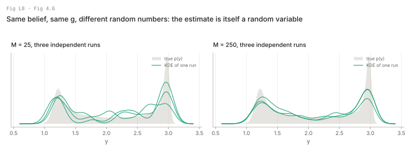

**Intuition.** A particle set is a random draw, so two identical robots with identical beliefs and actions end up with different particle beliefs (p. 108). The spread falls as 1/√M: the standard deviation of the sample mean of y is 0.146 at M = 25 and 0.046 at M = 250, a ratio of 3.19 against √10 ≈ 3.16.

**Formal.** No new equation. This is the O(1/√M) of (4.28) seen from the other side: the estimate does not drift, it jitters.

**Your robots.** Pick M by measuring this: run RoboCup MCL twice on the same log with different seeds. If the runs disagree by more than the behaviour layer's tolerance, M is too small.

---

## L9. Resampling (4.3.4, (4.36), Table 4.4)

**Picture.** Left: a robot that does not move and has no sensor, resampled at every step with equal weights. Right: the low-variance sampler's comb after Fig 4.7.

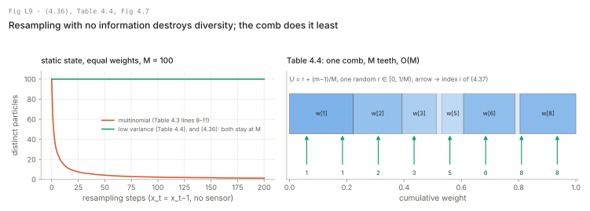

**Intuition.** Drawing with replacement copies some particles and drops others even when weights are equal, so without information the set collapses and the robot reports a certainty it never had (p. 109). With M = 100, multinomial resampling leaves 16.7 distinct particles after 10 steps (mean of 40 runs), 2.3 after 100, 1.3 after 200. Fixes: resample less often, and use one random number instead of M; the low-variance sampler keeps all 100.

**Formal.** Resample only when needed, multiplying weights in between (4.36):

```latex
w_t^{[m]} = \begin{cases} 1 & \text{if resampling took place} \\ p(z_t \mid x_t^{[m]})\, w_{t-1}^{[m]} & \text{if no resampling took place} \end{cases}
```

Decide by the variance of the weights; never resample a state known to be static (p. 109). Table 4.4, with normalized weights:

| Line | Equation |
| --- | --- |
| 3 | r = rand(0; M⁻¹) |
| 4–5 | c = w^[1], i = 1 |
| 7 | U = r + (m − 1) · M⁻¹ |
| 8–10 | while U > c: i = i + 1, c = c + w^[i] |
| 12 | add x^[i] to X̄ₜ |

Each U picks the first index whose cumulative weight reaches it (4.37):

```latex
i = \operatorname*{argmin}_j \sum_{m=1}^{j} w_t^{[m]} \geq U
```

Three advantages (p. 111): systematic coverage, no loss when all weights are equal, O(M) instead of the O(M log M) of M independent binary searches.

**Traps.** Table 4.4 assumes Σw = 1 (r ∈ [0, M⁻¹), U up to 1); Table 4.3 never normalizes. Feed it raw likelihoods: with Σw < 1 the while loop runs past index M; with Σw > 1 the tail particles are never drawn. The book's "stratified sampling" (p. 111) is a two-stage scheme over groups of particles; what the literature calls stratified resampling is one random number per stratum [(m−1)/M, m/M). Card C5 implements both, named apart.

**Your robots.** When the tracked robot stops, suspend resampling and usually the measurement updates too (p. 109). Gate resampling on N_eff < M/2 (outside the book; L6) and use the low-variance sampler everywhere.

---

## L10. Sampling bias (4.3.4, (4.38))

**Picture.** One update of a 1-D Gaussian prior with a Gaussian measurement whose exact posterior mean is 1.0. The curve is the expected particle-filter mean over 40,000 runs at each M.

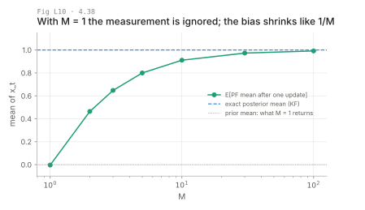

**Intuition.** With one particle, resampling takes it whatever its weight, so the measurement does nothing. Expected PF means: −0.003 at M = 1 (zero up to Monte Carlo noise), 0.464 at M = 2, 0.911 at M = 10, 0.992 at M = 100. More runs do not remove the bias; only more particles do.

**Formal.** With M = 1 the weight is its own normalizer (4.38):

```latex
p(\text{draw } x_t^{[m]} \text{ in line 9}) = \frac{w_t^{[m]}}{w_t^{[m]}} = 1
```

In general the M unnormalized weights carry M degrees of freedom and the normalized ones only M − 1 (p. 112). Book exercise 3 asks for the M = 2 case by hand; Fig L10's value at M = 2 is the number to check your algebra against.

**Your robots.** Bias bites when M is forced small: a PF on a microcontroller, or many small per-hypothesis filters.

---

## L11. Particle deprivation (4.3.4, pp. 112–113)

**Picture.** A ring-corridor robot localized by range to the next door, M = 300, picked up and moved 5 m at t = 30. Median error over 20 runs, with and without random particle injection.

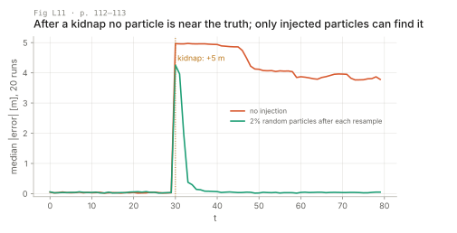

**Intuition.** The filter can only weight particles it has. If bad luck or a kidnap leaves none near the truth, no likelihood creates one. In Fig L11 none of 20 runs recovers without injection; with 2% of particles replaced by uniform draws after each resample, all 20 recover, median 4 steps.

**Formal.** No equation. Losing every particle near the truth has positive probability at every step, usually exponentially small in M, so a long run eventually fails (pp. 112–113). Injection reduces but does not fix this and makes the posterior incorrect; the book calls it a last resort. Ch. 8 gives augmented MCL.

**Your robots.** A RoboCup referee moving the robot is a literal kidnap; so is a track-slip the motion model did not allow. Keep injection off by default (card C4); switch it on when the best likelihood stays low for several steps, and log it.

### 4.4 Summary

The chapter's summary (pp. 113–114) restates that both converge to the true posterior as the number of values grows, that dynamic decompositions beat static ones but are harder to build, and that particle filters are the most versatile Bayes filter in the book.

### 4.5 Bibliographical remarks (skip)

Doucet et al. (2001) is the follow-up text; nothing here is needed for the exercises.

---

## L12. How to tell which method you need

| Symptom | Likely cause | Try |
| --- | --- | --- |
| Gaussian filter's mean between two plausible poses | multimodal belief | histogram or particle filter (L1) |
| Grid filter too slow, memory exponential | state dimension ≥ 3 at fine resolution | convolution for line 3; selective updating; particle filter (L3) |
| Occupancy cell stuck at 0 or 1 in probability form | saturation | log odds (Table 4.2), `expit`, clamp l (L4) |
| Occupancy map drifts toward empty or full with no evidence | prior not subtracted in line 2 | subtract l₀ every update (L4) |
| All weights zero or NaN | likelihood underflow | weights in log space, log-sum-exp normalize (L6) |
| Most weights near zero, N_eff ≪ M after every update | proposal much wider than likelihood | better proposal; widen likelihood; more particles (L6) |
| Two runs on the same log disagree | sampling variance | larger M; low-variance resampling (L8, L9) |
| Stationary robot becomes falsely certain | resampling without information | suspend resampling when static; N_eff trigger (L9) |
| Low-variance sampler returns index out of range | unnormalized weights into Table 4.4 | normalize before resampling (L9) |
| Estimate ignores measurements at small M | sampling bias | more particles (L10) |
| Confident and wrong after a kidnap or slip | particle deprivation | random injection as last resort; augmented MCL in ch. 8 (L11) |

The question that decides between the two families is the one on p. 113: how many values does the belief need, given the state dimension and how spread out it is. A grid answers it in advance and pays everywhere; particles answer it at run time and pay only where the belief is.
