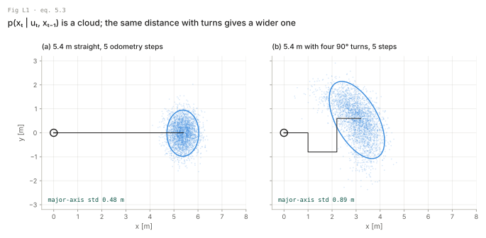
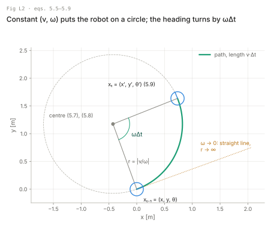
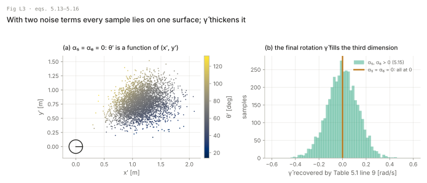
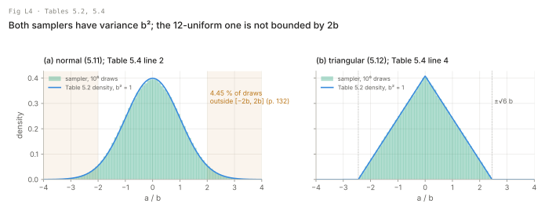
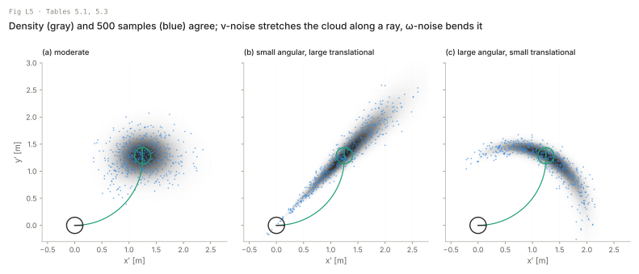
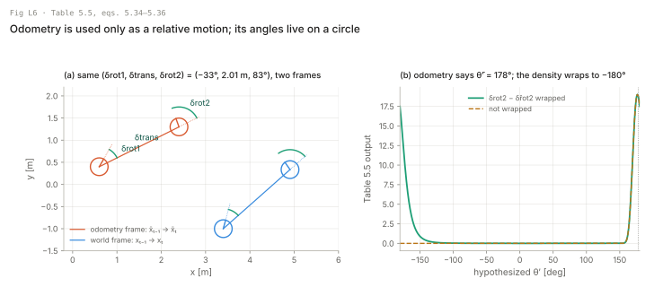
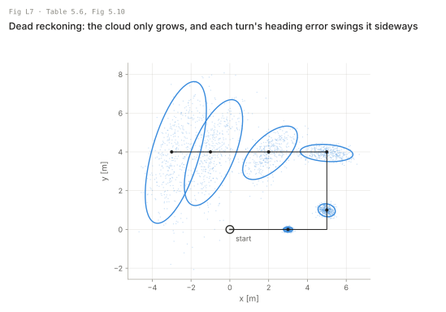
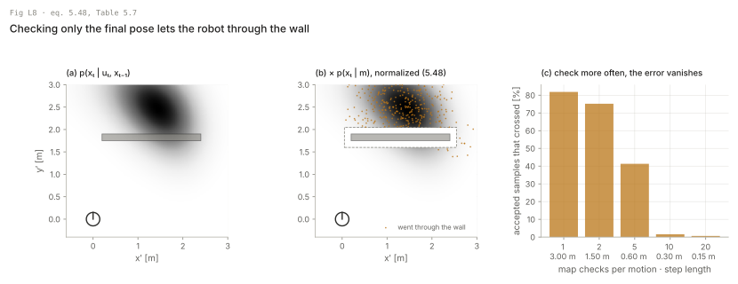
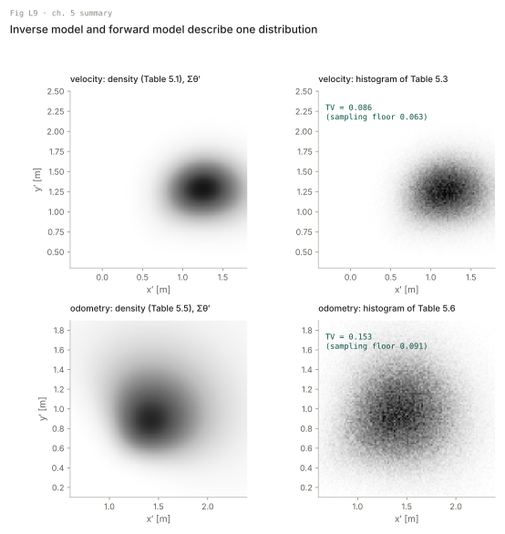

# Lecture: Robot motion

Each section is taught in four layers: the picture, the intuition, the formal statement, and where it meets your robots. Equation and table numbers are the book's; page numbers are printed pages. Code is in `translate.md`; nothing here is a solution to an exercise. Every number below comes from `figures/make_figures.py` and is stored in `figures/numbers.json`.

---

## L1. The motion model is the predict step (5.1, 5.2.2)

**Picture.** A motion gives a cloud of poses, not a pose. The same distance driven with turns gives a wider cloud, because every turn's heading error swings everything that comes after it.



**Intuition.** Kinematics tells you where a perfect robot ends up. The chapter makes it probabilistic in the cheapest way possible: keep the kinematics and put noise on what drives them (velocities or odometry increments). The book's practical claim on p. 118 matters more than any formula: models that overestimate uncertainty work better, because they absorb unmodelled state and Markov violations. A too-tight motion model is the most common reason a filter becomes confident and wrong.

**Formal.** The state transition of the Bayes filter (Table 2.1 line 3):

```latex
p(x_t \mid u_t, x_{t-1}) \qquad (5.3)
```

xₜ, xₜ₋₁ ∈ ℝ² × S¹ are poses (x, y, θ) (5.1); uₜ is either a velocity command (5.4) or an odometry pair (5.33). Fig 5.2 projects this 3-D density onto x–y. Two models, two uses (p. 121): the velocity model works before the motion happens, so planners use it; the odometry model is more accurate but only exists after the motion, so estimators use it.

In Fig L1 both paths are 5.4 m in five odometry steps with the same α = (0.02, 0.002, 0.02, 0.005) (Table 5.6, sampled step by step). The straight one ends with a major-axis standard deviation of 0.481 m, the one with four 90° turns 0.888 m.

**Your robots.** The tracked robot runs this at odometry rate as the predict step of its localizer. The quadruped and the drone mostly do not: their predict step is an IMU-driven process model (lesson t2.6), and the book says on p. 121 that its models exclude legged robots.

### 5.2.1 Kinematic configuration (skim)

Pose is (x, y, θ) (5.1), θ = 0 along the x-axis, counterclockwise positive, and θ = 0.5π points along y (p. 119). Location is (x, y) without θ (5.2). This matches ROS REP 103 (x forward, y left, yaw counterclockwise; from outside the book). The book writes (5.9) and (5.40) as coordinate sums, but they are exactly SE(2) composition of the old pose with a body-frame motion, so chaining them agrees with Barfoot's transform notation. What the coordinate form hides is that θ lives on S¹: every angle difference in this chapter must be wrapped.

---

## L2. Exact motion on a circle (5.3, 5.3.3 "Exact Motion", (5.4)–(5.9))

**Picture.** Hold (v, ω) constant and the robot traces an arc of radius |v/ω| about a centre to its side; the heading turns by exactly the angle swept.



**Intuition.** A differential or skid-steer base commanded in (v, ω) moves on a circle. Everything in 5.3 is this circle: the sampler runs it forward, the density finds the circle through two given poses and reads off what (v, ω) would have produced it. The circle's one weakness is ω = 0, where the centre is at infinity and the formulas divide by zero.

**Formal.** The control is

```latex
u_t = (v_t \;\; \omega_t)^T \qquad (5.4)
```

v in m/s, positive forward; ω in rad/s, positive counterclockwise (p. 121). The radius and centre:

```latex
r = \left|\frac{v}{\omega}\right| \quad (5.5) \qquad v = \omega \cdot r \quad (5.6)
```
```latex
x_c = x - \tfrac{v}{\omega}\sin\theta \quad (5.7) \qquad y_c = y + \tfrac{v}{\omega}\cos\theta \quad (5.8)
```
```latex
\begin{pmatrix} x' \\ y' \\ \theta' \end{pmatrix}
= \begin{pmatrix} x \\ y \\ \theta \end{pmatrix}
+ \begin{pmatrix} -\frac{v}{\omega}\sin\theta + \frac{v}{\omega}\sin(\theta+\omega\Delta t) \\
                  \frac{v}{\omega}\cos\theta - \frac{v}{\omega}\cos(\theta+\omega\Delta t) \\
                  \omega\Delta t \end{pmatrix} \qquad (5.9)
```

The derivation in one idea: the robot covers v·Δt of arc and turns by ω·Δt, and its position is the point on the circle about (x_c, y_c) at the angle perpendicular to its heading (p. 127). In Fig L2 (v = 1.0 m/s, ω = 0.8 rad/s, Δt = 2.0 s), (5.9) and an RK4 integration of the unicycle ODE agree to 8 × 10⁻¹³ (largest difference over x, y in m and θ in rad). For velocities that change within the interval, the book concatenates short constant-velocity arcs (p. 127).

**Your robots.** This is the tracked robot's command interface: the skid-steer controller takes (v, ω). It is also the g(u, x) of the ch. 3 EKF example; ch. 7 linearizes it. The quadruped's body-velocity command has a lateral component v_y that (5.4) cannot express; that is book exercise 7 (holonomic) in this package.

---

## L3. Noise on the controls, and why a third term (5.3.3 "Real Motion", "Final Orientation", (5.10)–(5.16))

**Picture.** Perturb only v and ω and every sample lands on one surface in (x, y, θ): θ′ is fixed once (x′, y′) is. The final rotation γ̂ gives the cloud thickness in θ.



**Intuition.** The real robot does not execute (v, ω) but (v̂, ω̂). Noise proportional to the commanded speeds is the natural model: a robot at rest does not drift, a fast one drifts a lot. Two noise variables cannot fill a 3-D pose space; the posterior would be a 2-D sheet, and any pose a sensor suggests off that sheet would get probability zero. The book's fix is an extra rotation γ̂ at the end of the motion. It is a modelling device, not physics.

**Formal.** The executed velocities:

```latex
\begin{pmatrix}\hat v \\ \hat\omega\end{pmatrix}
= \begin{pmatrix} v \\ \omega \end{pmatrix}
+ \begin{pmatrix} \varepsilon_{\alpha_1 v^2 + \alpha_2 \omega^2} \\ \varepsilon_{\alpha_3 v^2 + \alpha_4 \omega^2} \end{pmatrix} \qquad (5.10)
```

ε_{b²} is zero-mean with variance b²; α₁–α₄ ≥ 0 are robot-specific (p. 127). Units follow: α₁ is dimensionless (m²/s² per m²/s²), α₂ is m² (m²/s² per rad²/s²), α₃ is 1/m², α₄ dimensionless. Substituting (v̂, ω̂) into (5.9) gives (5.13). The fix:

```latex
\theta' = \theta + \hat\omega\Delta t + \hat\gamma\Delta t \quad (5.14) \qquad
\hat\gamma = \varepsilon_{\alpha_5 v^2 + \alpha_6 \omega^2} \quad (5.15)
```

and the full generative model (5.16) is (5.13) with (5.14) in the third row. In Fig L3 the inverse model (Table 5.1 line 9) recovers γ̂ from each sample: with α₅ = α₆ = 0 the largest |γ̂| is 5.9 × 10⁻¹⁶ rad/s (rounding), with α₅, α₆ > 0 its standard deviation is 0.128 rad/s against 0.128 rad/s from (5.15).

**Your robots.** On the tracked robot the real third term is track slip in a turn, which rotates the body more or less than ω̂Δt; γ̂ is a crude stand-in for it. If the logs show slip spikes in pivot turns, the book's quadratic in ω may be too gentle; T5 handles spins with a separate spin noise term on the odometry model, not by changing this law.

---

## L4. Error densities and their samplers (Tables 5.2 and 5.4, (5.11), (5.12))

**Picture.** Both error models have variance b²; the normal one has infinite support, the triangular one stops at ±√6 b. The 12-uniform sampler makes a good normal and is not bounded by 2b.



**Intuition.** The motion models only need two primitives: evaluate a zero-mean density with variance b², and draw from it. Normal is the default. Triangular is cheaper and has compact support, which makes a density exactly zero beyond ±√6 b; that is a feature for rejection (no pose is "slightly possible") and a bug for robustness (one outlier gives a zero likelihood that never recovers).

**Formal.** Table 5.2:

| Line | Equation |
| --- | --- |
| 2 | prob_normal(a, b²) = (2πb²)^(−1/2) exp(−a²/(2b²))  (5.11) |
| 4 | prob_triangular(a, b²) = max{0, 1/(√6 b) − \|a\|/(6b²)}  (5.12) |

Table 5.4: sample_normal returns ½ Σᵢ₌₁¹² rand(−b, b) (line 2); sample_triangular returns (√6/2)[rand(−b, b) + rand(−b, b)] (line 4). Both have variance b²: each uniform contributes (2b)²/12 = b²/3, so line 2 gives 12 · b²/3 · ¼ = b² and line 4 gives 2 · b²/3 · 6/4 = b² (book exercise 8). Over 10⁶ draws at b = 1 the sample variances are 1.0003 and 1.0007.

**Print error, p. 132.** The text says the 12-uniform sampler's values "lie always in [−2b, 2b]". Its support is [−6b, 6b]: 4.45 % of the draws fell outside ±2b, and the largest seen was 5.02 b. The claim to keep is the variance, which is right.

**Your robots.** When b² = 0 (robot at rest, v = ω = 0) Table 5.2 line 2 is 0/0; every implementation needs a floor on b² (card C1).

---

## L5. Density and sampler for the velocity model (5.3.1, 5.3.2, Tables 5.1 and 5.3)

**Picture.** Figs 5.3 and 5.4 redrawn on one axis: the gray density of Table 5.1 summed over θ′, and 500 blue draws of Table 5.3 on top. Noise on v stretches the cloud along a ray from the start, because scaling v scales the whole arc; noise on ω bends it into a banana around the start.



**Intuition.** Sampling runs the robot forward with perturbed velocities; that is a simulator and it is easy. The density runs the robot backward: given where it ended, which (v̂, ω̂, γ̂) would have got it there, and how likely are those deviations from the command. Inverting kinematics is harder and has singular cases, which is why particle filters, which need only sampling, are easier to implement (p. 125).

**Formal.** Table 5.1, motion_model_velocity(xₜ, uₜ, xₜ₋₁):

| Line | Equation | Step |
| --- | --- | --- |
| 2 | μ = ½ [(x − x′)cos θ + (y − y′)sin θ] / [(y − y′)cos θ − (x − x′)sin θ] | where the centre sits on the bisector |
| 3–4 | x* = (x + x′)/2 + μ(y − y′), y* = (y + y′)/2 + μ(x′ − x) | centre of the circle |
| 5 | r* = √((x − x*)² + (y − y*)²) | radius |
| 6 | Δθ = atan2(y′ − y*, x′ − x*) − atan2(y − y*, x − x*) | angle swept |
| 7–8 | v̂ = (Δθ/Δt) r*, ω̂ = Δθ/Δt | controls that explain the move |
| 9 | γ̂ = (θ′ − θ)/Δt − ω̂ | final rotation |
| 10 | return prob(v − v̂, α₁v² + α₂ω²) · prob(ω − ω̂, α₃v² + α₄ω²) · prob(γ̂, α₅v² + α₆ω²) | (5.32) |

Table 5.3, sample_motion_model_velocity(uₜ, xₜ₋₁): lines 2–4 draw v̂, ω̂, γ̂ by (5.10) and (5.15); lines 5–7 apply (5.16). Shapes: every quantity is a scalar; with M particles, each line is a length-M vector operation.

**Traps the cards fix (decided in `map.md`).**
1. **Line 7 drops the sign of v̂.** r* is positive and Δθ carries the sign of the turn, so v̂ carries the sign of ω, not of the motion: right turns and reversing get the wrong sign. Card C3 trick 1 gives the measured cases and the fix.
2. **Line 2 divides by zero for a straight line**, and Table 5.3 lines 5–6 divide by ω̂ = 0. Both need a straight-line branch.
3. **Lines 6 and 9 are angle differences** and must be wrapped.

**Your robots.** The tracked robot's local planner can use Table 5.3 to roll out a command 2 s ahead and count samples that hit an obstacle: that is the "probabilistic motion planning" use of p. 121. The ch. 7 EKF linearizes (5.9) instead and maps the (v, ω) noise through the control Jacobian; this table is the nonlinear truth that linearization approximates.

### 5.3.3 Computation of p(xₜ ∣ uₜ, xₜ₋₁) (skim, derive (5.17)–(5.25))

The derivation behind Table 5.1 (pp. 129–132): the centre of a circle through (x, y) and (x′, y′) lies on their perpendicular bisector, and must also lie on the line through (x, y) perpendicular to the initial heading. Intersecting the two gives μ (5.17)–(5.18) and the centre (5.19); r* and Δθ follow, and v̂, ω̂, γ̂ are read off (5.23)–(5.25). The errors v − v̂, ω − ω̂, γ̂ (5.26)–(5.31) are independent, so the density is their product (5.32). Do the bisector algebra once by hand (T2.2 in this package); it is where the sign of line 7 is lost. (5.32) is a density over the noise variables, not over the pose; L9 measures what that costs.

---

## L6. The odometry model (5.4, 5.4.1, Table 5.5, (5.33)–(5.36))

**Picture.** Odometry is used only through the relative motion it reports, rotate–translate–rotate. The same three numbers move the robot in the world frame, wherever the odometry frame has drifted to. And because two of them are angles, the density must be computed on the circle.



**Intuition.** The odometry frame drifts against the world without limit (knowing the transform would solve localization, p. 133), but the difference between two consecutive odometry poses is a good estimate of the true motion. Any planar relative motion can be written as a turn toward the target, a straight drive, and a turn to the final heading; these three numbers are a sufficient statistic (p. 135). Three noise terms on three parameters, so no degeneracy and no γ̂.

**Formal.** The control is the odometry pair

```latex
u_t = \begin{pmatrix} \bar x_{t-1} \\ \bar x_t \end{pmatrix} \qquad (5.33)
```

with x̄ₜ₋₁ = (x̄, ȳ, θ̄), x̄ₜ = (x̄′, ȳ′, θ̄′) in the robot's internal frame. Treating a measurement as a control keeps velocities out of the state (p. 133). Table 5.5, motion_model_odometry(xₜ, uₜ, xₜ₋₁):

| Line | Equation | Step |
| --- | --- | --- |
| 2–4 | δrot1 = atan2(ȳ′ − ȳ, x̄′ − x̄) − θ̄, δtrans = ‖(x̄′, ȳ′) − (x̄, ȳ)‖, δrot2 = θ̄′ − θ̄ − δrot1 | measured motion (5.34)–(5.36) |
| 5–7 | the same three on (xₜ₋₁, xₜ), hatted | hypothesized motion |
| 8 | p₁ = prob(δrot1 − δ̂rot1, α₁δ̂²rot1 + α₂δ̂²trans) | (5.44), but see trap 3 |
| 9 | p₂ = prob(δtrans − δ̂trans, α₃δ̂²trans + α₄δ̂²rot1 + α₄δ̂²rot2) | (5.45) |
| 10 | p₃ = prob(δrot2 − δ̂rot2, α₁δ̂²rot2 + α₂δ̂²trans) | (5.46) |
| 11 | return p₁ · p₂ · p₃ | independence |

Units: α₁ and α₃ dimensionless, α₂ in rad²/m², α₄ in m²/rad². In Fig L6a the odometry pair decomposes into (−33.4°, 2.012 m, 83.4°).

**Traps.**
1. **Wrap every angular difference** (p. 135 says this for δrot2 − δ̂rot2 and calls it "difficult to debug"; it holds for lines 2, 4, 5, 7, 8 too). In Fig L6b the odometry ends at θ̄′ = 178°; without wrapping, 47.7 % of the density over θ′ is lost on the other side of ±180°.
2. **A rotation in place has δtrans = 0**, and line 2 is atan2(0, 0): δrot1 is arbitrary and the split between δrot1 and δrot2 is meaningless. Card C4 sets δrot1 = 0 below a translation threshold.
3. **Lines 8–10 scale the variances with the hypothesized δ̂; the book disagrees with itself.** (5.44)–(5.46) on p. 139 and Table 5.6 use the measured δ. Card C4 uses the measured δ, so that density and sampler describe one distribution (L9).

**Your robots.** On the RoboCup robot and on FORGE, walking odometry reported as (δrot1, δtrans, δrot2) between keyframes is exactly the relative-pose factor between consecutive poses in the factor graph, with α giving its covariance. The book's claim that odometry is usually more accurate than the commands (pp. 121, 132) is untested on the tracked robot. In this package's T5 simulation odometry still beats the commands on driving steps once spins have their own noise term (test log-likelihood 6.59 per step, 7.06 once the encoders' turn over-report χ is divided out, against 6.13 for the velocity model), but that slip model is one the package chose, so check it on your logs; a gyro for θ helps either way.

---

## L7. Sampling the odometry model and dead reckoning (5.4.2, Table 5.6, Fig 5.10)

**Picture.** Fig 5.10 redrawn: sample odometry step by step around a rectangle with no measurements. The cloud grows along the path and is bent by every corner.



**Intuition.** The sampler is (5.40): perturb the three parameters and drive. Repeating it is dead reckoning, and nothing in the motion model ever shrinks the cloud; only a measurement update (ch. 6) does. Heading error is what hurts: a small error in δrot1 early on becomes a lateral error proportional to every metre driven afterwards.

**Formal.** Table 5.6, sample_motion_model_odometry(uₜ, xₜ₋₁): lines 2–4 are (5.34)–(5.36); lines 5–7 subtract a sample with the variances of (5.37)–(5.39), scaled by the measured δ; lines 8–10 are (5.40):

```latex
\begin{pmatrix} x' \\ y' \\ \theta' \end{pmatrix}
= \begin{pmatrix} x \\ y \\ \theta \end{pmatrix}
+ \begin{pmatrix} \hat\delta_\text{trans}\cos(\theta+\hat\delta_\text{rot1}) \\
                  \hat\delta_\text{trans}\sin(\theta+\hat\delta_\text{rot1}) \\
                  \hat\delta_\text{rot1} + \hat\delta_\text{rot2} \end{pmatrix} \qquad (5.40)
```

In Fig L7 (α = (0.01, 0.0005, 0.01, 0.0005), 0.5 m steps, 17.0 m path), the standard deviation along the cloud's major axis is 0.118 m after 3 m, 0.225 m after 6 m, 0.682 m after 9 m (just past the second turn), 0.888 m after 12 m and 1.894 m at the end. It grows faster than linearly in distance: a heading error acts on every metre that follows. The book adds that at about 10 Hz the velocity and odometry models differ little (p. 136).

**Your robots.** This is line 4 of MCL on the RoboCup field (ch. 8). Run it open-loop on a logged lap of the tracked robot with your α and compare the final cloud to ground truth: if the truth falls outside the cloud, α is too small, and by p. 118 that is the dangerous direction.

### 5.4.3 Mathematical derivation of the odometry model (skim)

The derivation (pp. 137–139) is the same three equations read forward and backward. Forward: subtract noise from the measured δs (5.37)–(5.39) and drive (5.40); that is Table 5.6. Backward: compute the δ̂s that take xₜ₋₁ to the hypothesized xₜ, take the differences (5.41)–(5.43) as the errors, and score them independently (5.44)–(5.46); that is Table 5.5.

---

## L8. Motion and maps (5.5, (5.47)–(5.51), Table 5.7)

**Picture.** Fig 5.11 redrawn. Multiplying by p(xₜ ∣ m) removes the mass inside the obstacle (grown by the robot radius), but keeps the mass behind it, including poses the robot could reach only by driving through the wall. Checking the map at more points along the motion removes that error.



**Intuition.** A map says where the robot cannot be. The exact map-conditioned motion model would need the probability that a free path exists, which is expensive. The book's approximation checks only the end pose: cheap, and wrong exactly when a whole wall fits inside one motion step. At high update rates the step is shorter than any wall, and the error disappears (p. 143), provided the noise is bounded, as the book assumes there; with Gaussian noise it only becomes small.

**Formal.**

```latex
p(x_t \mid u_t, x_{t-1}) \neq p(x_t \mid u_t, x_{t-1}, m) \qquad (5.47)
```
```latex
p(x_t \mid u_t, x_{t-1}, m) = \eta\, \frac{p(x_t \mid u_t, x_{t-1})\, p(x_t \mid m)}{p(x_t)} \qquad (5.48)
```

p(xₜ ∣ m) is zero in occupied configuration space and constant elsewhere; p(xₜ) is taken as uniform and absorbed in η. The derivation in one idea: Bayes rule (5.49) on m, then the approximation (5.51) p(m ∣ xₜ, uₜ, xₜ₋₁) = p(m ∣ xₜ), which throws away the path (5.50). Table 5.7: motion_model_with_map returns the product (line 2); sample_motion_model_with_map draws from any motion sampler until p(xₜ ∣ m) > 0 and returns the sample with weight π. The table numbers two lines 3 (print error); the loop has no bound, and p. 141 warns about termination.

In Fig L8, 82.1 % of the samples land in free space. Among those, the fraction whose arc crossed the grown wall (0.45 m thick in configuration space) depends on how many points of the motion are checked against the map. One check (the end pose, step 3 m): 81.9 %. Two (1.5 m): 75.2 %. Five (0.6 m): 41.3 %. Ten (0.3 m): 1.6 %. Twenty (0.15 m): 0.6 %. The error drops sharply once the step is shorter than the wall, the book's argument on p. 143. With a retry cap of 10 the chance that every retry fails is 3.4 × 10⁻⁸ here; in a narrow corridor it is not small, so card C5 caps retries and returns the last sample with weight 0.

**Your robots.** In MCL on the tracked robot, a particle-wide p(xₜ ∣ m) check after line 4 kills particles inside walls; at 10 Hz and 0.5 m/s a step is 5 cm, far below any wall plus robot radius. The through-the-wall case appears when odometry is batched (a dropped message, a long pause) and one step suddenly covers metres. The drone's planner checks the swept path, not the end pose; that is planning, outside this book.

---

## L9. Two models, two forms, one distribution (5.6)

**Picture.** For each model, the density summed over θ′ next to a histogram of 400,000 draws of its sampler. The difference between them is close to the difference between two independent sample sets.



**Intuition.** The summary (pp. 143–144) is a 2 × 2: velocity or odometry input, density or sampling form. The density inverts the kinematics and scores the implied noise; the sampler adds the noise and runs the kinematics. If both are implemented right, they describe the same distribution, and that is the test to write first.

**Formal.** Total variation distance between the normalized x–y grids, TV = ½ Σ |p − q|: velocity model 0.086 (two sample sets against each other: 0.063); odometry model 0.153 (floor 0.091). The floor for one sample set against an exact density is lower still, since only one side is noisy. Two causes explain the excess, and dividing them out closes it (computed in `make_figures.py`, from outside the book). First, the missing Jacobian of L5's skim note. Divide Table 5.1 by |det ∂(x′, y′, θ′)/∂(v̂, ω̂, γ̂)| and the velocity TV drops to 0.044. Second, for odometry, Table 5.5 scales its variances with δ̂ where Table 5.6 (and (5.44)–(5.46)) use δ. Dividing by the Jacobian determinant δ̂trans alone gives 0.134; adding Table 5.6's variances gives 0.064. Neither matters for a particle filter, which only samples. Both matter in grid localization, where Table 5.5 is the transition: the grid filter then uses a slightly different motion model than the particle filter. The book's closing list of what is not covered (p. 144): holonomic robots, cars with suspension, dynamics, inertial sensing.

**Your robots.** The drone needs everything p. 144 leaves out: dynamics with velocity in the state and an IMU as the motion input (lesson t2.6). The quadruped needs the holonomic model (book exercise 7). The tracked robot fits the chapter as is, with slip-aware α.

### 5.7 Bibliographical remarks (skip)

Siegwart and Nourbakhsh (2004) for the kinematics of other drive types; nothing here is needed for the exercises.

---

## L10. How to tell which method you need

| Symptom | Likely cause | Try |
| --- | --- | --- |
| Filter confident and wrong after a few metres | α too small; motion model tighter than reality | inflate α (p. 118); fit α on logged data (T5) (L1, L7) |
| Density zero for every pose a sensor suggests | α₅ = α₆ = 0: posterior on a 2-D sheet | nonzero final-rotation noise (5.15) (L3) |
| NaN in the velocity density at rest | b² = 0 when v = ω = 0 | floor on b² (L4) |
| NaN or inf on straight-line motion | Table 5.1 line 2 or Table 5.3 lines 5–6 with ω = 0 | straight-line branch (L5) |
| Right turns or reversing scored as unlikely | Table 5.1 line 7 loses the sign of v̂ | sign from the displacement along the heading, card C3 (L5) |
| Likelihood collapses when θ crosses ±180° | unwrapped angular difference | wrap every angle difference (L6) |
| Odometry density jumps for a turn in place | atan2(0, 0) in Table 5.5 line 2 | δrot1 = 0 below a translation threshold (L6) |
| Particles behind a wall after a long step | map checked at the end pose only (5.51) | shorter steps, more map checks per motion (L8) |
| Map-based sampler hangs | unbounded do–until in Table 5.7 | cap retries, return weight 0 (L8) |
| Density and sampler disagree beyond the sampling floor | sign, wrap or variance mismatch between Tables 5.1/5.3 or 5.5/5.6 | TV test of L9 |

The choice between the two models is the one on p. 121: velocity if the motion has not happened yet (planning, control), odometry if it has (estimation). The choice between the two forms is the algorithm's: particle filters sample, grid and EKF-style filters need the density.
